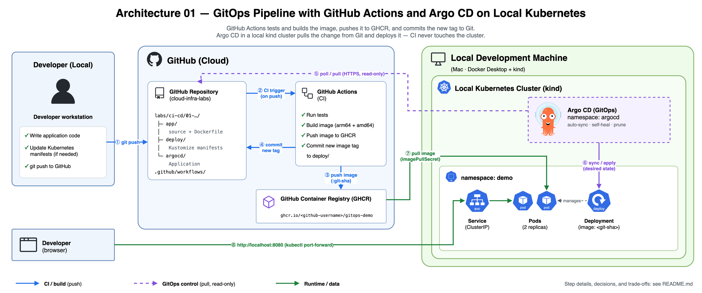

# Architecture 01 — GitOps Pipeline with GitHub Actions and Argo CD on Local Kubernetes

> A GitOps CI/CD pipeline that runs on a Mac: GitHub Actions builds and publishes the image,
> and Argo CD in a local kind cluster pulls the change from Git and deploys it.

**Related lab:** [Lab 01 — GitOps Pipeline with GitHub Actions and Argo CD on Local Kubernetes](../../labs/ci-cd/01-gitops-github-actions-argocd/README.md)

## Requirements

- **Functional**
  - A push to `main` tests, builds, and publishes a container image automatically.
  - The cluster updates to the new version with no manual `kubectl`.
  - Manual changes in the cluster are reverted to match Git (self-heal).
  - Rollback is a `git revert`.
- **Non-functional**
  - Runs entirely on one Mac (Apple Silicon, 8 GB RAM).
  - Costs $0 (local cluster, GitHub free tier).
  - CI has no cluster credentials; Argo CD and image pulls are read-only.
  - Every running image traces back to a Git commit.
  - High availability is out of scope (single-node local cluster).

## Diagram

## Components

| Component | Tool | What it does |
|---|---|---|
| Developer workstation | Mac, git | Writes the app code and manifests, and pushes them to GitHub. |
| Source repository | GitHub repo | The single source of truth: app source (`app/`), desired cluster state (`deploy/`), the Argo CD Application (`argocd/`), and the CI workflow. |
| CI pipeline | GitHub Actions | On every push: runs tests, builds the image for arm64 and amd64, pushes it to GHCR, and commits the new image tag to `deploy/`. |
| Container registry | GHCR | Stores the images, tagged with the Git commit SHA. Private; the cluster pulls with read-only access. |
| Manifests | Kustomize | Describes the Deployment and Service. CI changes only the image name and tag in `kustomization.yaml`. |
| Kubernetes cluster | kind on Docker Desktop | A single-node Kubernetes cluster running locally; hosts Argo CD and the app. |
| GitOps controller | Argo CD (namespace `argocd`) | Watches `deploy/` in Git, compares it with the cluster, and applies the difference. Auto-sync, self-heal, and prune are on. |
| Application | Deployment, 2 pods (namespace `demo`) | Runs the demo app. Changing the image tag triggers a rolling update. |
| Service | Kubernetes Service (ClusterIP) | A stable in-cluster address that load-balances across the pods. |
| Local access | `kubectl port-forward` | Exposes the Service at `http://localhost:8080` for testing, so no Ingress is needed. |

Why each tool was chosen over the alternatives: see [Key decisions and trade-offs](#key-decisions-and-trade-offs).

## Local environment

Everything except GitHub runs on one Mac. Step-by-step guide:
[SETUP.md](../../labs/ci-cd/01-gitops-github-actions-argocd/SETUP.md).

| Item | Value |
|---|---|
| Machine | Apple Silicon Mac (arm64), 8 GB RAM |
| Container runtime | Docker Desktop: 4 CPUs, 5 GB memory, 1 GB swap |
| Kubernetes | kind, single node (control plane and workloads on one node) |
| Namespaces | `argocd` (Argo CD), `demo` (the application) |
| App URL | `http://localhost:8080` via `kubectl port-forward -n demo svc/demo 8080:80` |
| Argo CD UI | `https://localhost:8443` via `kubectl port-forward -n argocd svc/argocd-server 8443:443` |
| Network | Outbound only, to GitHub and GHCR. Nothing on the Mac is exposed to the internet. |
| Tool versions | Listed in [SETUP.md](../../labs/ci-cd/01-gitops-github-actions-argocd/SETUP.md#5-check-every-tool) |

## Request / data flow

1. The developer pushes code and/or manifests to the GitHub repository.
2. The push triggers GitHub Actions (CI): tests run and the image is built for arm64 and amd64.
3. The image is pushed to GHCR, tagged with the Git commit SHA.
4. The workflow commits the new tag to `deploy/` (Kustomize), using `GITHUB_TOKEN` with `contents: write`.
5. Argo CD polls the repo over HTTPS (read-only) and detects the change.
6. Argo CD syncs the desired state into the cluster (Deployment, Service).
7. Kubernetes pulls the image from GHCR using a read-only `imagePullSecret`.
8. The developer opens the app at `http://localhost:8080` via `kubectl port-forward`.

## Key decisions and trade-offs

| Decision | Options considered | Chosen | Why |
|---|---|---|---|
| Deployment model | CI pushes to the cluster (`kubectl apply`) · GitOps pull | **GitOps pull (Argo CD)** | CI never holds cluster credentials; Git is the single source of truth; drift is detected and reverted |
| Local Kubernetes | kind · k3d · minikube · Docker Desktop Kubernetes | **kind** | Lightweight, standard for labs and CI, close to upstream Kubernetes |
| Image registry | Docker Hub · GHCR | **GHCR** | Free, and CI logs in with the built-in `GITHUB_TOKEN` |
| Image tag | `latest` · semantic version · Git commit SHA | **Git commit SHA** | Every deploy traces to a commit; rollback is `git revert` |
| Image platforms | amd64 only · arm64 + amd64 | **arm64 + amd64** | The Mac is Apple Silicon; an amd64-only image fails with `exec format error` |
| Manifests | Plain YAML · Helm · Kustomize | **Kustomize** | Built into kubectl; CI updates the tag with one command |
| Repo layout | Separate app and config repos · one repo | **One repo** (portfolio) | Simpler to follow; production teams often split app and config repos |
| Image visibility | Public · private + `imagePullSecret` | **Private** | Least privilege; the cluster gets read-only pull access |

## Security

- **No CI → cluster access:** GitHub Actions has no kubeconfig; only Argo CD changes the cluster.
- **No repo credentials** for Argo CD: it reads the public repo over HTTPS, read-only.
- **Read-only `imagePullSecret`** for the cluster to pull from GHCR.
- **Least-privilege CI token:** the workflow's `GITHUB_TOKEN` gets only `contents: write` and `packages: write`.
- **Secret scanning:** `gitleaks` runs on every push.

## Scaling and reliability

**What happens when something fails**

| Failure | Effect | Recovery |
|---|---|---|
| Tests or build fail in CI | No image is pushed and no tag is committed; the cluster keeps running the current version | Fix the code and push again |
| Bad release (app starts but is broken) | The readiness probe fails, so the rolling update stops and the old pods keep serving | `git revert` the commit; Argo CD rolls back |
| A pod crashes | The Deployment replaces it; the second replica keeps serving | Automatic |
| Someone changes the cluster by hand (`kubectl scale`, `kubectl edit`) | Argo CD detects drift | Self-heal reverts it to match Git |
| Argo CD is down | No new deployments; the running app is not affected | Argo CD re-syncs from Git when it restarts |
| GHCR is unreachable | New pods can't pull the image; running pods are not affected | Pulls succeed once GHCR is back |
| The cluster is lost | Everything in the cluster is gone | Recreate it with kind, install Argo CD, apply the Application; Argo CD rebuilds the rest from Git |

**Backups:** Git is the backup. The app is stateless, so the whole desired state lives in the
repo and the cluster can be rebuilt from it at any time.

**No CI loop:** the tag commit from step ④ uses `GITHUB_TOKEN`, and commits made with that
token do not trigger new workflow runs.

**Scaling:** replicas are set in `deploy/` and changed through Git, never with `kubectl scale`
(self-heal would revert it). The local cluster has a single node, so this design shows the
workflow, not real scaling. In production it would run on a multi-node cluster (e.g. EKS)
spread across availability zones.

## Cost estimate

**$0.** The cluster runs locally on kind; GitHub Actions and GHCR are used within GitHub's free tier.

## What I'd improve next

- **Supply-chain security:** sign images with Cosign in CI and verify signatures before they
  run in the cluster.
- **Image scanning:** scan images with Trivy in CI and fail the build on critical
  vulnerabilities.
- **Environment promotion:** dev → prod with Kustomize overlays, promoted by pull request.
- **Faster sync:** a GitHub webhook to Argo CD instead of polling (needs a reachable Argo CD
  endpoint, so not used locally).
- **Ingress** instead of `kubectl port-forward`, for real HTTP routing.
- **Production platform:** run the same flow on EKS built with Terraform, with Argo CD
  ApplicationSets to manage many apps and environments.
- **Observability:** Prometheus and Grafana for the app, and Argo CD notifications for sync
  failures.
