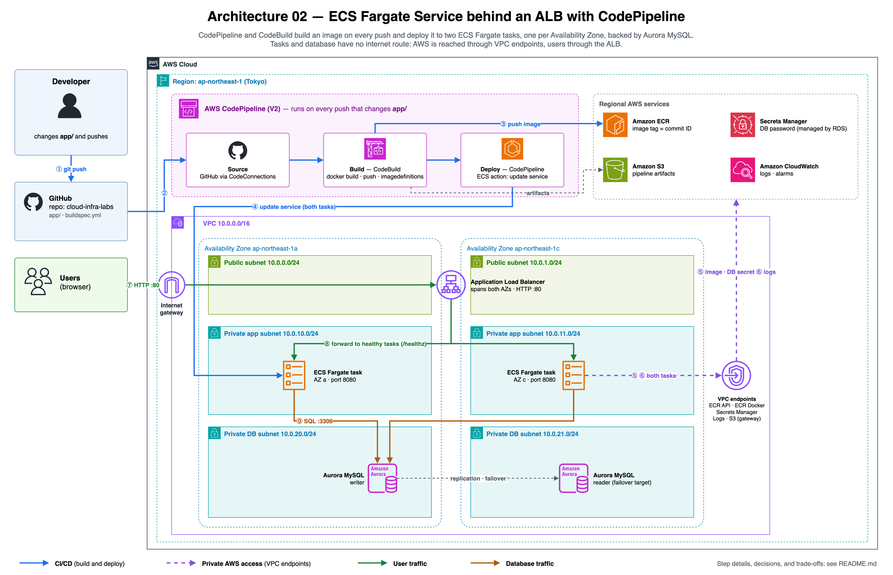

# Architecture 02 — ECS Fargate Service behind an ALB with CodePipeline

> A highly available container web service on AWS: an Application Load Balancer in front of
> two ECS Fargate tasks (one per Availability Zone) in private subnets with no internet
> access, backed by an Aurora MySQL cluster, and deployed by CodePipeline and CodeBuild on
> every push to GitHub. Infrastructure is built with Terraform.

**Related lab:** Lab 01 (aws) — ECS Fargate Service behind an ALB with CodePipeline *(in progress)*

## Requirements

- **Functional**
  - Users reach the web app over HTTP through a single public endpoint (the ALB DNS name).
  - The app stores data in a MySQL-compatible database (a visit counter), which survives task
    restarts and deployments.
  - A push to `main` that changes the app builds a new image and deploys it to ECS with no
    manual steps.
  - A broken release is rolled back automatically.
  - All infrastructure is created and destroyed with Terraform.
- **Non-functional**
  - **Survives the loss of one Availability Zone:** one task in each of two AZs, and an
    Aurora reader in the second AZ that takes over as writer.
  - The app and the database run in **private subnets with no internet route** (no NAT
    gateway, no public IPs); the app reaches AWS services only through VPC endpoints.
  - Only the ALB can reach the app, and only the app can reach the database.
  - No long-lived credentials: pipeline and tasks use IAM roles; the database password is
    generated and stored by AWS (Secrets Manager); GitHub is connected with AWS
    CodeConnections.
  - Every running image traces back to a Git commit.
  - Data is encrypted at rest, and can be restored to a point in time.
  - Fully removable with `terraform destroy` (a lab: about $10 per day while running).

## Diagram

## Components

| Component | Tool | What it does |
|---|---|---|
| Source repository | GitHub | Holds the app source and `buildspec.yml`. A push to `main` starts the pipeline. |
| Repo connection | AWS CodeConnections | Lets CodePipeline read the GitHub repo without storing a GitHub token in AWS. |
| Pipeline | AWS CodePipeline (V2) | Runs three stages in order: **Source → Build → Deploy**. Starts only when the app's files change. |
| Build | AWS CodeBuild | Builds the image, tags it with the commit ID, pushes it to ECR, and writes `imagedefinitions.json` for the deploy stage. |
| Pipeline artifacts | Amazon S3 | Stores the files passed between stages (source zip, `imagedefinitions.json`). Encrypted, no public access. |
| Image registry | Amazon ECR | Stores the images. Tags are immutable, and old images expire by lifecycle policy. |
| Network | Amazon VPC | 2 Availability Zones, each with three subnet tiers: public (ALB), private app (tasks), private DB (Aurora). No NAT gateway. |
| Private AWS access | VPC endpoints | Interface endpoints for ECR (API and Docker), Secrets Manager, and CloudWatch Logs, plus a gateway endpoint for S3 (image layers), so the tasks never need the internet. |
| Load balancer | Application Load Balancer | The public entry point. Spreads HTTP traffic across the healthy tasks in both AZs and checks `/healthz`. |
| Container service | Amazon ECS on AWS Fargate | Runs 2 tasks of the web app, one per AZ. Rolling deployments with a circuit breaker that rolls back a failed release. |
| Database | Amazon Aurora MySQL | A writer instance in AZ a and a reader in AZ c. Storage is replicated across 3 AZs; if the writer fails, the reader is promoted. |
| Database password | AWS Secrets Manager | Holds the database password, generated and managed by RDS. ECS injects it into the tasks at start-up as an environment variable. |
| Logs and alarms | Amazon CloudWatch | Task logs, plus alarms for ALB 5xx errors, unhealthy targets, task CPU, and database CPU and connections. |
| Permissions | AWS IAM | Separate least-privilege roles for CodePipeline, CodeBuild, the ECS task execution (pull image, read the DB secret, write logs), and the task itself. |
| Infrastructure as code | Terraform | Creates everything above; state is stored in S3. |

Why each tool was chosen over the alternatives: see [Key decisions and trade-offs](#key-decisions-and-trade-offs).

## Environment

| Item | Value |
|---|---|
| AWS account | A dedicated lab or dev account (not production) |
| Region | `ap-northeast-1` (Tokyo) |
| Availability Zones | 2 (`ap-northeast-1a`, `ap-northeast-1c`) |
| VPC CIDR | `10.0.0.0/16` |
| Public subnets (ALB) | `10.0.0.0/24`, `10.0.1.0/24` |
| Private app subnets (tasks, endpoints) | `10.0.10.0/24`, `10.0.11.0/24` |
| Private DB subnets (Aurora) | `10.0.20.0/24`, `10.0.21.0/24` |
| Internet access | Inbound HTTP :80 to the ALB only. Tasks and database have no internet route. |
| App URL | `http://<alb-dns-name>/` (Terraform output) |
| Terraform state | S3 bucket with native state locking |

## Request / data flow

Numbered to match the arrows in the diagram.

**Deployment (CI/CD)**

1. The developer pushes a change to the app to `main` on GitHub.
2. CodePipeline's **Source** stage picks up the commit through CodeConnections.
3. The **Build** stage runs CodeBuild: build the image, push it to ECR tagged with the commit
   ID, and write `imagedefinitions.json`.
4. The **Deploy** stage tells ECS to update the service to the new image. ECS replaces the
   tasks one at a time, so one task keeps serving throughout.
5. Each new task pulls its image from ECR and reads the database password from Secrets
   Manager, through the VPC endpoints.
6. The tasks send their logs to CloudWatch Logs through the VPC endpoint.

**User request**

7. A user opens `http://<alb-dns-name>/`; the request enters through the internet gateway to
   the ALB.
8. The ALB forwards it to a healthy task in either AZ on port 8080.
9. The task reads and updates the visit counter in Aurora through the cluster's writer
   endpoint (MySQL, port 3306).

## Key decisions and trade-offs

| Decision | Options considered | Chosen | Why |
|---|---|---|---|
| Compute | EC2 instances · ECS on EC2 · ECS Fargate · EKS | **ECS Fargate** | No servers to patch; a small, fixed number of tasks; simpler than Kubernetes |
| Number of tasks | 1 · 2 (one per AZ) | **2, one per AZ** | Survives an AZ failure; deployments replace one task at a time, so there is no downtime |
| Database | RDS for MySQL · Aurora MySQL · DynamoDB | **Aurora MySQL** | MySQL-compatible; storage replicated across 3 AZs; faster failover than RDS Multi-AZ |
| Database topology | Single writer · writer + reader in another AZ | **Writer + reader** | The reader is promoted if the writer or its AZ fails |
| Database password | In code or Terraform variables · Secrets Manager (managed by RDS) | **Secrets Manager, managed by RDS** | Nobody sees or types the password; ECS injects it at start-up; it can be rotated |
| Health check | Check the database in `/healthz` · app-only `/healthz` | **App-only** | A short Aurora failover must not mark both tasks unhealthy and take the whole app offline |
| Network tiers | Tasks and database in the same subnets · separate DB subnets | **Separate private DB subnets** | Clear boundary; the database security group only accepts the app tier |
| Outbound access for the tasks | Public subnets with public IPs · NAT gateway · VPC endpoints | **VPC endpoints** | No internet route at all (closed-network style); cost is similar to a NAT gateway |
| CI/CD | GitHub Actions · CodePipeline + CodeBuild | **CodePipeline + CodeBuild** | Runs inside AWS with IAM roles, so no AWS keys leave AWS; native ECS deploy action |
| Deploy model | GitOps controller (pull) · pipeline deploys (push) | **Push (CodePipeline ECS action)** | ECS has no in-cluster GitOps controller; the pipeline's IAM role is limited to updating this one service |
| GitHub connection | Personal access token · CodeConnections | **CodeConnections** | No GitHub token stored in AWS; access is granted through a GitHub App |
| Image tag | `latest` · commit ID | **Commit ID** (immutable tags in ECR) | Every running task traces to a commit; a tag can never be overwritten |
| Base image source | Docker Hub · ECR Public mirror | **ECR Public** (`public.ecr.aws/docker/library/python`) | Avoids Docker Hub rate limits on CodeBuild's shared IP addresses |
| Deployment safety | Plain rolling update · rolling update with circuit breaker · blue/green (CodeDeploy) | **Rolling update with circuit breaker** | Automatic rollback of a failed release with no extra service; blue/green is a later improvement |
| Infrastructure as code | Console · CloudFormation · Terraform | **Terraform** | Repeatable, reviewable, and one command to destroy everything |

## Security

- **No internet route for the app or the database:** both run in private subnets with no
  public IP and no NAT gateway. The tasks reach ECR, S3, Secrets Manager, and CloudWatch Logs
  only through VPC endpoints.
- **Security groups, one per tier:** the ALB accepts HTTP :80 from the internet; the tasks
  accept :8080 **only from the ALB**; Aurora accepts :3306 **only from the tasks**; the
  interface endpoints accept HTTPS only from inside the VPC.
- **Least-privilege IAM roles:** CodeBuild can push to this one ECR repository; CodePipeline
  can update this one ECS service and pass only the task roles; the task execution role can
  pull images, read **this one** database secret, and write logs; the task role has no
  permissions (the app needs none).
- **No long-lived credentials:** everything uses IAM roles; the database password lives only
  in Secrets Manager; GitHub access goes through CodeConnections instead of a stored token.
- **Encryption:** Aurora storage, the artifact bucket, ECR, and the secret are encrypted at
  rest; the S3 buckets block all public access.
- **Container hardening:** the app runs as a non-root user.
- **Secret scanning:** `gitleaks` runs on every push to the repository.

## Scaling and reliability

**What happens when something fails**

| Failure | Effect | Recovery |
|---|---|---|
| Build fails (tests or image build) | The pipeline stops at Build; nothing is deployed | Fix the code and push again |
| New task fails its health check | The circuit breaker stops the deployment; the old tasks keep serving | Automatic rollback to the last working task definition |
| One task crashes | The ALB sends all traffic to the other task; no outage | ECS starts a replacement automatically |
| An Availability Zone fails | The task in the other AZ keeps serving. If the Aurora writer was in the failed AZ, the reader is promoted (usually within a minute) and the app briefly gets database errors | Automatic: ECS restarts the lost task in the healthy AZ; the app reconnects to the new writer |
| The Aurora writer fails | Writes fail briefly | The reader is promoted automatically; the writer endpoint follows it |
| A VPC endpoint is unavailable | New tasks can't start (no image, no secret); running tasks keep serving | Recovers when the endpoint is back |
| A bad release that passes the health check | Users get the broken version | Revert the commit in Git; the pipeline deploys the previous version |

**Backups:** Aurora takes automated backups with point-in-time restore (1 day of retention in
the lab; 7 days or more in production). Git holds the source, ECR holds every image, and
Terraform can rebuild all infrastructure.

**Scaling:** the app tier scales by adding tasks (production would add target-tracking auto
scaling on CPU). Read traffic can move to the reader endpoint, and more readers can be added.

## Cost estimate

Approximate on-demand prices in `ap-northeast-1`; check the
[AWS Pricing Calculator](https://calculator.aws/) for current numbers.

| Item | Approx. cost |
|---|---|
| Aurora MySQL: 2 × `db.t4g.medium` (writer + reader) | ~$0.23 per hour (+ small storage and I/O charges) |
| 4 interface endpoints × 2 AZs | ~$0.11 per hour |
| Application Load Balancer | ~$0.03 per hour (+ small usage charge) |
| 2 Fargate tasks, 0.25 vCPU / 0.5 GB each | ~$0.03 per hour |
| S3 gateway endpoint | Free |
| Secrets Manager (1 secret) | ~$0.40 per month |
| CodeBuild, CodePipeline (V2) | A few cents per pipeline run |
| ECR, S3, CloudWatch Logs | Cents per month at lab scale |
| **Total while running** | **~$0.40 per hour (~$10 per day)** |

The biggest cost drivers are the two Aurora instances, then the interface endpoints; all are
charged per hour even with no traffic. Run the lab and `terraform destroy` on the same day.

## What I'd improve next

- **Auto scaling:** target-tracking scaling of the tasks on CPU or request count.
- **HTTPS:** an ACM certificate and Route 53 domain on the ALB, with HTTP redirected to HTTPS.
- **RDS Proxy:** connection pooling, and faster, smoother failovers for the app.
- **Aurora Serverless v2:** scale database capacity with load instead of fixed instances.
- **Blue/green deployments** with CodeDeploy, with automatic rollback on CloudWatch alarms.
- **Supply-chain security:** sign images in CodeBuild with Cosign and AWS KMS, and verify
  them before deployment.
- **Image scanning:** ECR enhanced scanning (Amazon Inspector); fail the pipeline on critical
  findings.
- **Edge protection:** AWS WAF on the ALB.
- **Multiple environments:** dev / stg / prd from the same Terraform code with per-environment
  variables, promoted through the pipeline with a manual approval stage.
- **Alerting:** send the CloudWatch alarms to SNS (email or chat).
