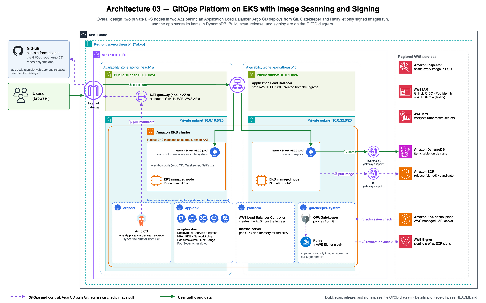
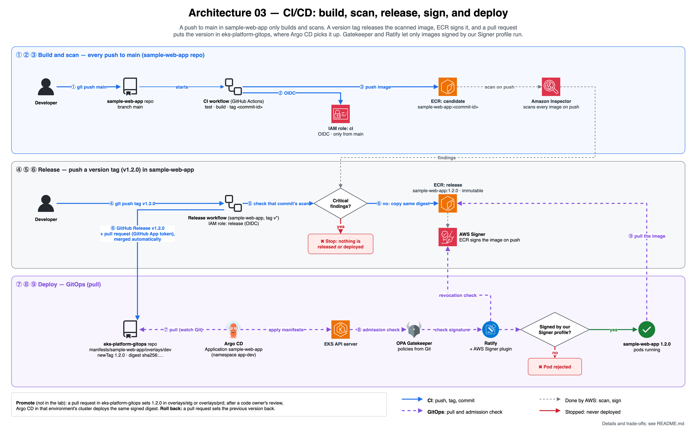

# Architecture 03 — GitOps Platform on EKS with Image Scanning and Signing

> A Kubernetes platform on Amazon EKS, designed the way a platform team runs one: GitHub Actions
> builds and scans every change, a version tag (`v1.2.0`) releases an image only if Amazon
> Inspector found no critical vulnerabilities, Amazon ECR signs it with AWS Signer, Argo CD
> deploys it from Kustomize manifests in a GitOps repository, and OPA Gatekeeper with Ratify
> lets the cluster run only signed images. A small web app (a page plus the REST API behind it)
> stores its data in DynamoDB. As in a company, the app code, the GitOps configuration, and the
> infrastructure (Terraform) live in separate repositories.

**Related lab:** [Lab 01 (kubernetes) — GitOps Platform on EKS with Image Scanning and Signing](../../labs/kubernetes/01-eks-gitops-image-scanning-signing/README.md)

## Requirements

- **Functional**
  - Users store items and later retrieve or update them at the load balancer's address, through
    a **web page** (a table of the items, with add and edit) or the **REST API** behind it
    (create, list, get, update). The page shows the running version. The data lives in DynamoDB
    and survives pod restarts and deployments.
  - A push to `main` in the app repository (`sample-web-app`) tests the app, builds an image, and
    scans it. **It deploys nothing.**
  - **A version tag releases:** pushing a tag such as `v1.2.0` in `sample-web-app` turns that
    commit's image into release `1.2.0` and deploys it to dev through the GitOps repository
    (`eks-platform-gitops`, pull-based GitOps), with no other manual steps. Promoting to stg or
    prd is a reviewed pull request in the GitOps repository that sets the same version in that
    environment's manifests.
  - **Code and configuration are kept apart:** the app's code is in its own repository,
    everything Argo CD deploys is in the GitOps repository, and the AWS infrastructure is
    Terraform in this lab. Argo CD reads only the GitOps repository.
  - The app is deployed from **plain Kubernetes manifests in Git** (Kustomize: a shared `base/`
    and a small overlay per environment).
  - **An image with a critical vulnerability is never released:** the release stops before the
    image reaches the release repository.
  - **The cluster runs only images our pipeline signed:** an unsigned image, or one from another
    registry, is rejected when the pod is created.
  - Cluster add-ons (load balancer controller, metrics) and the admission policies are
    installed from Git by Argo CD, like the app; nothing is installed by hand.
  - A bad release is rolled back by setting the previous version back in Git.
  - All AWS infrastructure is created and destroyed with Terraform.
- **Non-functional**
  - **Survives the loss of one node or one Availability Zone's pods:** two nodes in two AZs, at
    least two app replicas spread across them. Out of scope for the lab: losing the AZ that holds
    the single NAT gateway (see [Scaling and reliability](#scaling-and-reliability)).
  - Nodes run in **private subnets** with no public IPs; only the load balancer and the NAT
    gateway are in public subnets.
  - **No long-lived cloud credentials:** GitHub Actions gets short-lived AWS credentials through
    OIDC; pods get AWS permissions through EKS Pod Identity; the CI pipeline never holds cluster
    credentials. The only stored secret is a GitHub App key that can change nothing but the
    GitOps repository.
  - Least privilege inside the cluster: each namespace has quotas and limits, network traffic is
    denied unless a policy allows it, and pods must run as non-root with a read-only root file
    system.
  - Every running image traces back to a version tag, a Git commit, and an image digest; a
    released version can never be overwritten.
  - **No AWS account ID in Git**, including the ECR address in the manifests.
  - Fully removable with `terraform destroy` (a lab: about $8–9 per day while running).

## Diagram

**Overall design:** where everything runs, and how users, Argo CD, and the pods reach it
(steps 7–11).



**CI/CD flow:** how a change becomes a running version: build and scan, release, deploy
(steps 1–9).



Both are pages of [diagram.drawio](./diagram.drawio). The numbers match
[Request / data flow](#request--data-flow).

## Components

| Component | Tool | What it does |
|---|---|---|
| App repository | GitHub: `sample-web-app` | The app's code, Dockerfile, tests, and its CI and release workflows. Tags such as `v1.2.0` are the app's versions. |
| GitOps repository | GitHub: `eks-platform-gitops` | Argo CD objects (`apps/`) and Kubernetes manifests (`manifests/`, Kustomize overlays per environment). Argo CD reads only this repository. |
| CI workflow | GitHub Actions in `sample-web-app` (on push to `main`) | Tests and builds the image, tags it with the commit ID, and pushes it to `candidate` for scanning. Deploys nothing. |
| Release workflow | GitHub Actions in `sample-web-app` (on a `v*` tag) | Checks the tagged commit's scan result, copies the image to `release` as the version (`1.2.0`, same digest), creates a GitHub Release, and opens a pull request in the GitOps repository that sets the version and digest in the dev overlay; it merges automatically. |
| Release access to the GitOps repository | GitHub App | Gives the release workflow a one-hour token that can push a branch and open pull requests in `eks-platform-gitops` only. |
| CI access to AWS | IAM OIDC provider for GitHub | Gives each workflow short-lived credentials for one IAM role, limited to the `sample-web-app` repository (its `main` branch for CI, its `v*` tags for releases). No AWS keys are stored in GitHub. |
| Image registry | Amazon ECR (2 repositories) | `candidate`: every build, tagged with its commit ID, scanned on push. `release`: only released versions (`1.2.0`) that passed the scan; signed; tags are immutable, so a version can't be overwritten. |
| Vulnerability scanning | Amazon Inspector (ECR enhanced scanning) | Scans each image on push for OS and language-package vulnerabilities, and rescans when a new CVE affects it. |
| Image signing | AWS Signer (ECR managed signing) | Signs each image pushed to the `release` repository automatically, using a Signer signing profile. Signatures are stored in ECR next to the image. |
| Network | Amazon VPC | 2 AZs; public subnets (load balancer, NAT gateway) and large private subnets for nodes and pod IPs. |
| Outbound access | NAT gateway (1) | Lets the private nodes reach GitHub (Argo CD), ECR, and AWS APIs. |
| Private AWS access | Gateway endpoints for S3 and DynamoDB | Image layers (S3) and app data (DynamoDB) stay on the AWS network and don't pass through the NAT gateway. Free. |
| Kubernetes control plane | Amazon EKS | Managed control plane; API access through EKS access entries; Kubernetes secrets encrypted with a KMS key. |
| Nodes | EKS managed node group | 2 × `t3.medium`, one per AZ, in private subnets. AWS patches the node AMI; Terraform sets the size. |
| Cluster networking | Amazon VPC CNI (EKS add-on) | Gives each pod an IP from the VPC, and enforces Kubernetes NetworkPolicies. |
| Pod access to AWS | EKS Pod Identity (Pod Identity Agent add-on); one IRSA role | Maps a Kubernetes service account to one IAM role: the app to its DynamoDB table, the load balancer controller to ELB APIs, the EBS CSI driver to EBS. Ratify uses IRSA instead: its ECR login reads only IRSA's settings. |
| Other EKS add-ons | CoreDNS, kube-proxy, EBS CSI driver | Cluster DNS, service routing, and volumes (managed by EKS). |
| GitOps controller | Argo CD | Runs in the cluster, pulls from the GitOps repository, and keeps the cluster matching it (sync and self-heal). App-of-apps: one root Application creates the others. AppProjects limit what each group of Applications may deploy, and where. |
| One Application per namespace | Argo CD ApplicationSets (cluster generator) | Create one Application per namespace (`argocd`, `gatekeeper`, `platform`, `sample-web-app`) and fill in each cluster's own values from its annotations, which Terraform sets: ECR registry and release repository, cluster name, VPC ID, region, and the GitOps repository's address. Nothing account-specific is written in Git. |
| Admission policies | OPA Gatekeeper | Checks every new pod in the `app-*` namespaces against policies from the GitOps repository: signed image, our `release` repository only, image referenced by digest, read-only root file system, CPU and memory limits. Its audit re-checks running pods every minute. |
| Signature verification | Ratify, with the AWS Signer plugin | Answers Gatekeeper's question "is this image signed by our Signer profile, and is the signature still valid?": it checks the signature against AWS Signer's root certificate and asks Signer whether it was revoked. |
| Pod security | Pod Security Admission (built into Kubernetes) | The `restricted` level on the `app-*` namespaces: pods run as non-root, with no privilege escalation, all Linux capabilities dropped, and a seccomp profile. |
| Load balancing | AWS Load Balancer Controller | Creates an Application Load Balancer from the app's Ingress and sends traffic straight to the pod IPs. |
| Metrics | metrics-server | Pod CPU and memory, used by the HorizontalPodAutoscaler. |
| App | `sample-web-app` (container) | A web page at `/` (a table of the items, with add and edit, and the running version) and the REST API it calls: `POST/GET /items`, `GET/PUT /items/{id}`, `/info` (name and version), `/healthz`. Stores items in DynamoDB. |
| Database | Amazon DynamoDB | One on-demand table for the items. No servers, encrypted at rest, point-in-time recovery. |
| Infrastructure as code | Terraform (in this lab's folder of `cloud-infra-labs`) | Creates the AWS side (VPC, EKS, node group, ECR, Signer profile, IAM, DynamoDB), installs Gatekeeper and Ratify, installs Argo CD once, registers the cluster in Argo CD with its environment label and per-cluster annotations, and creates the root Application; Argo CD then manages itself and everything else from the GitOps repository. |

Why each tool was chosen over the alternatives: see [Key decisions and trade-offs](#key-decisions-and-trade-offs).

## Repositories

As in most companies, each repository has one owner and one job, and Argo CD never reads the app
code.

| Repository | Holds | Owned by (in a company) | Read by |
|---|---|---|---|
| `sample-web-app` | App code, Dockerfile, tests, the CI and release workflows | The app team | GitHub Actions |
| `eks-platform-gitops` | Argo CD objects and Kubernetes manifests: platform add-ons, policies, and the app's overlay per environment | The platform team; app teams change their own overlays by pull request | Argo CD (read only) |
| `cloud-infra-labs` (this repository) | This design, the lab guide, and the Terraform for the AWS side | The platform team; stands in for an infrastructure repository | You, with `terraform apply` |

The app repository (the GitOps repository's layout is in
[Kubernetes platform design](#kubernetes-platform-design)):

```
sample-web-app/
├── .github/workflows/
│   ├── ci.yml              push to main: test, build, push to ECR candidate (scanned)
│   └── release.yml         tag v*: check the scan, copy to ECR release (signed),
│                           GitHub Release, pull request to eks-platform-gitops
├── Dockerfile
└── src/                    web page, REST API, tests
```

**How a release reaches the GitOps repository:** the release workflow gets a token from a GitHub
App that is installed only on `eks-platform-gitops` and may only push branches and open pull
requests there; the token lasts one hour. The pull request sets the new version and digest in
`overlays/dev`; the workflow first checks that the overlay still builds with the new image, then
merges the pull request. A `CODEOWNERS` file requires a
reviewer for every other path, so the automatic pull request can change nothing but dev's
version; stg and prd always wait for a review.

## Environment

| Item | Value |
|---|---|
| Environments | dev, stg, and prd, each in its **own AWS account** with its own cluster and state. The manifests have a Kustomize overlay for each. **The lab deploys only dev.** |
| AWS account | The dev account (not production) |
| Region | `ap-northeast-1` (Tokyo) |
| Availability Zones | 2 (`ap-northeast-1a`, `ap-northeast-1c`) |
| VPC CIDR | `10.0.0.0/16` |
| Public subnets (load balancer, NAT) | `10.0.0.0/24`, `10.0.1.0/24` |
| Private subnets (nodes and pods) | `10.0.16.0/20`, `10.0.32.0/20`: large, because every pod takes a VPC IP |
| Kubernetes version | The current EKS standard-support version, pinned in Terraform |
| Cluster API access | Private endpoint for the nodes; public endpoint limited to the admin's IP address. The CI pipeline never calls the API: it only writes to Git. |
| Internet access | Inbound HTTP :80 to the load balancer only. Outbound from the nodes through the NAT gateway. |
| App URL | `http://<load-balancer-dns-name>/` (the web page; the API is under `/items`) |
| Terraform state | S3 bucket with native state locking, one state per stack (network, cluster, platform); no account ID in any file (read from the AWS login, as in Architecture 02) |

## Kubernetes platform design

How the cluster is organised, following common platform-team practice.

**Namespaces and Argo CD Applications:** one Argo CD Application per namespace, so each part
syncs, shows its health, and rolls back on its own.

| Namespace | What runs there | Argo CD Application (source in `manifests/`) | Values that differ per cluster |
|---|---|---|---|
| `kube-system` | EKS add-ons: VPC CNI, CoreDNS, kube-proxy, Pod Identity Agent, EBS CSI driver | None: EKS managed add-ons, set by Terraform | — |
| `argocd` | Argo CD | `argocd` (`argocd/`). Terraform installs Argo CD once; after that, Argo CD upgrades itself from the GitOps repository | — |
| `gatekeeper-system` | OPA Gatekeeper, Ratify, and the policies | `gatekeeper` (`gatekeeper/`): the policies only. Terraform installs Gatekeeper and Ratify themselves (see [Key decisions](#key-decisions-and-trade-offs)) | ECR registry and release repository, the only one the policies allow. Ratify gets the Signer profile ARN from Terraform |
| `platform` | AWS Load Balancer Controller, metrics-server | `platform` (`platform/`, two Helm charts) | Cluster name, VPC ID, region |
| `app-dev` | The app, at Pod Security Admission's `restricted` level | `sample-web-app` (`sample-web-app/overlays/dev`) | ECR registry and release repository |

**GitOps repository layout** (`eks-platform-gitops`): the Argo CD objects (*which* manifests go
*where*) are kept apart from the manifests themselves (*what* is deployed).

```
eks-platform-gitops/
├── .github/CODEOWNERS             a reviewer for every path except overlays/dev
├── apps/                          Argo CD objects only
│   ├── projects.yaml              AppProjects: platform, workloads (what each may deploy, where)
│   ├── platform.yaml              ApplicationSets → Applications argocd, gatekeeper, platform
│   └── workloads.yaml             ApplicationSet → Application sample-web-app (namespace app-<env>)
└── manifests/                     what is deployed: plain Kubernetes YAML and Helm values
    ├── argocd/                    Argo CD's own Helm values
    ├── gatekeeper/                the policies for the app-* namespaces (Kustomize)
    │   ├── templates/             signature (Ratify), repository, digest, read-only, limits
    │   ├── constraints.yaml       where each policy applies: pods in app-*
    │   └── aws-signer-plugin.yaml loads the AWS Signer plugin into Ratify
    ├── platform/                  AWS Load Balancer Controller, metrics-server (Helm values)
    └── sample-web-app/
        ├── base/                  Deployment, Service, Ingress, HPA, PDB, NetworkPolicy, quota
        └── overlays/{dev,stg,prd}/  version + digest, settings, sizes per environment
```

- `manifests/` holds only Kubernetes YAML and Helm values, with no Argo CD objects, so it can be
  reviewed, and even applied, on its own.
- `apps/` decides where each part goes: the ApplicationSets create one Application per namespace
  in each cluster, and the AppProjects limit what each may deploy. The `workloads` project can
  deploy only into `app-*` namespaces, and its only cluster-wide object is its own namespace.

The app's manifests are plain YAML (Kustomize). An overlay holds only what differs per
environment; a release changes just the version and digest:

```yaml
# manifests/sample-web-app/overlays/dev/kustomization.yaml, after release 1.2.0
namespace: app-dev
resources:
  - ../../base
images:                          # written by the release workflow
  - name: sample-web-app
    newTag: "1.2.0"
    digest: sha256:…
configMapGenerator:
  - name: sample-web-app-settings
    literals:
      - AWS_REGION=ap-northeast-1
      - TABLE_NAME=k8slab01-dev-items
      - APP_VERSION=1.2.0        # written by the release workflow
```

**No account ID in Git.** Some values differ per account: the image address
(`<account-id>.dkr.ecr.ap-northeast-1.amazonaws.com/<release-repository>`) and the Signer profile
ARN, which both contain the account ID, and the cluster name and VPC ID. None of them is written
in a file. Terraform gives the profile ARN straight to Ratify when it installs it. The others it
sets on the cluster's entry in Argo CD as annotations, next to an environment label; the
ApplicationSets read them as they create each Application and pass them to Kustomize and Helm,
so the same files work for dev, stg, and prd, each in its own account.

**Standards every workload must meet** (enforced by Gatekeeper or Pod Security Admission, or set
in `base/`)

| Standard | How |
|---|---|
| Runs only images signed by our Signer profile, from our `release` repository | Gatekeeper asks Ratify to check the signature (made by our profile, not revoked); a second Gatekeeper policy allows only the `release` repository |
| Non-root, no privilege escalation, all Linux capabilities dropped, seccomp | Pod Security Admission, `restricted` level on the `app-*` namespaces |
| Read-only root file system | Gatekeeper policy; a writable `/tmp` comes from an `emptyDir` volume |
| Images referenced by digest, never by a tag alone (no `:latest`) | Gatekeeper policy; the release workflow writes the digest |
| CPU and memory requests and limits | Gatekeeper policy; `LimitRange` defaults per namespace |
| At least 2 replicas, spread across AZs | `topologySpreadConstraints`; `PodDisruptionBudget` keeps 1 running during node drains |
| Scales with load | `HorizontalPodAutoscaler` on CPU (2–4 replicas in dev) |
| Health checked | readiness and liveness probes on `/healthz` |
| Network traffic denied unless allowed | `NetworkPolicy`: default-deny in `app-dev`, then allow the load balancer → app on port 8080, and DNS |
| Namespace can't take the whole cluster | `ResourceQuota` per namespace |

## Release and promotion

| Event | What happens | Deployed? |
|---|---|---|
| Push to `main` in `sample-web-app` | Test, build, push to `candidate` as `<commit-id>`, Inspector scans it | **No** |
| Push a version tag in `sample-web-app`, e.g. `v1.2.0` | The release workflow checks that commit's scan, copies the image to `release` as `1.2.0` (ECR signs it), creates a GitHub Release, and opens a pull request in `eks-platform-gitops` setting `1.2.0` + digest in `overlays/dev`, which merges automatically | **Yes, to dev** (Argo CD) |
| Pull request in `eks-platform-gitops` setting `1.2.0` in `overlays/stg` or `overlays/prd`, approved by a code owner and merged | Argo CD in that environment's cluster deploys the same signed digest | **Yes, to stg / prd** (the lab deploys only dev) |
| Pull request in `eks-platform-gitops` setting the previous version back, merged | Argo CD deploys the previous signed digest | **Yes: rollback** |

Rules that keep releases safe:
- A version is released **from an image that was already built and scanned**; the release
  doesn't rebuild, so what was tested is exactly what runs.
- Every environment runs **the same digest** for a version; only the overlay differs.
- `release` tags are immutable: `1.2.0` can't be pushed twice with different content.
- Code and deployments are in different repositories: a version change never starts a build, and
  each repository has its own history, reviews, and permissions.

## Request / data flow

Numbered to match the arrows in the diagram.

**Build and scan (CI, every push to `main`)**

1. The developer pushes a change to `main` in the `sample-web-app` repository.
2. The CI workflow tests the app, builds the image, and gets short-lived AWS credentials through
   OIDC.
3. It pushes the image to the **`candidate`** repository, tagged with the commit ID. Amazon
   Inspector scans it on push. Nothing is deployed.

**Release (a version tag)**

4. The developer pushes a version tag in `sample-web-app`, e.g. `v1.2.0`, on a commit of `main`.
5. The release workflow checks that commit's scan result. If there is any **critical** finding,
   it stops: the image never reaches `release`, so it can never be deployed.
6. If the scan is clean, it copies the **same image (same digest)** to the **`release`**
   repository as `1.2.0`. ECR managed signing signs it with AWS Signer as it is pushed. The
   workflow creates a GitHub Release and, with a one-hour token from the GitHub App, opens a pull
   request in `eks-platform-gitops` that sets `1.2.0` and the digest in
   `manifests/sample-web-app/overlays/dev`; it merges automatically.

**Deploy (GitOps)**

7. Argo CD, running in the cluster, watches `eks-platform-gitops` and sees the merged change: the
   `sample-web-app` Application (namespace `app-dev`) syncs the new version, with the registry address
   from the cluster's annotations.
8. Before each new pod starts, the Kubernetes API server checks it against Pod Security
   Admission's `restricted` level and asks Gatekeeper. Gatekeeper checks its policies and asks
   Ratify about the image: Ratify reads the image's signature from ECR, checks that our Signer
   profile made it, and asks AWS Signer whether it was revoked. An unsigned image, or one from
   any other repository, is rejected.
9. The nodes pull the image from ECR: API calls through the NAT gateway, image layers from S3
   through the gateway endpoint.

**User request**

10. A user opens `http://<load-balancer-dns-name>/` in a browser (or calls the API); the
    Application Load Balancer (created by the AWS Load Balancer Controller from the Ingress) sends
    the request to a ready pod in either AZ. The page itself calls the same REST API.
11. The pod reads or writes the item in DynamoDB through the gateway endpoint, with credentials
    from EKS Pod Identity.

## Key decisions and trade-offs

| Decision | Options considered | Chosen | Why |
|---|---|---|---|
| Kubernetes | Self-managed (kubeadm on EC2) · ROSA · EKS | **EKS** | Managed control plane across AZs; native IAM and VPC integration; the most common choice on AWS |
| Nodes | Managed node group · Karpenter · Fargate | **Managed node group** | Simple and predictable for 2 nodes; AWS handles the AMI and node replacement. Karpenter pays off with many workloads and node types (an improvement below). Fargate can't run every add-on and costs more per pod |
| Deploy model | CI pushes with `kubectl` · GitOps pull (Argo CD) | **GitOps with Argo CD** | Git is the single source of truth; the CI pipeline never holds cluster credentials; drift is corrected and every change can be reverted in Git |
| Repositories | One repository for everything · **app, GitOps, and infrastructure in separate repositories** | **Separate**: `sample-web-app`, `eks-platform-gitops`, and Terraform in this lab | As in most companies: each team owns its repository and its permissions; deployment changes are reviewed apart from code; Argo CD reads only configuration, never the app code; the app's tags are its own versions |
| Version change in the GitOps repository | Argo CD Image Updater · a manual "promote" workflow · **a pull request from the release workflow (GitHub App)** | **Pull request through a GitHub App** | Every deployment is a reviewed, revertible commit, with no extra controller holding Git write access in the cluster; the App's token lasts one hour and works only on the GitOps repository. Trade-off: the App's private key is stored as a GitHub secret |
| Add-on installation | Terraform Helm releases · Argo CD from Git | **Argo CD from Git**; Terraform installs only Argo CD (which then manages its own upgrades) and the admission controllers | Add-ons are versioned and reviewed like the app; Terraform stays focused on AWS resources. The exception is Ratify: its chart makes its TLS certificate with Helm functions and hooks that only a real Helm install runs, so Terraform installs it, and Gatekeeper with it, since Ratify's install needs Gatekeeper running. Their policies still come from Git |
| Argo CD Applications | One per cluster (everything in one) · **one per namespace** | **One per namespace** | Each part syncs, shows its health, and rolls back on its own, so a broken policy change doesn't block an app release; AppProjects limit each Application to its own namespaces |
| GitOps repository layout | Applications next to their manifests · **Argo CD objects (`apps/`) apart from the manifests (`manifests/`)** | **Separate folders** | `manifests/` stays plain Kubernetes YAML and Helm values that work without Argo CD; changes to *what* is deployed and to *where* it goes are reviewed separately |
| When to release | Deploy every push to `main` · **release on a version tag** | **Version tag (`v1.2.0`)** | A push only builds and scans; a release is a deliberate, named version with a GitHub Release, and the same version is promoted unchanged to stg and prd |
| App manifests | Helm chart (templates, packaged in ECR) · **Kustomize (plain YAML in Git)** | **Kustomize** | What's in Git is exactly what's applied, so it's easy to review and debug; each environment's overlay changes only a few values. The add-ons still come as Helm charts |
| Per-account values (image registry, cluster name, VPC ID) | Written in the manifests · **cluster annotations read by the ApplicationSets** | **Cluster annotations** | The registry contains the account ID, which must not be in Git; Terraform knows the values and sets them on the cluster, so the same files work in every account. The Signer profile ARN goes from Terraform straight to Ratify |
| Vulnerability scanning | Trivy in CI · ECR basic scanning · **Inspector (ECR enhanced)** | **Inspector** | AWS-managed, scans OS and language packages, rescans when new CVEs appear, and shows where each image runs |
| Image signing | Cosign + KMS key · **AWS Signer via ECR managed signing** | **AWS Signer, managed by ECR** | No signing tool or key handling in the pipeline: ECR signs on push; Signer keys are AWS-managed; no extra charge |
| What a signature means | Sign every build · **sign only after the scan passes** | **Two repositories: `candidate` (scanned) → `release` (signed)** | Managed signing signs at push time, before a scan can finish. Signing only the `release` repository makes "signed" also mean "passed the scan", so the cluster check covers both |
| Signature check in the cluster | Kyverno + `kyverno-notation-aws` · Kyverno's newer image policies · **Ratify + OPA Gatekeeper** | **Ratify + Gatekeeper** | AWS documents both Kyverno and Ratify for Signer. But Kyverno 1.20 (November 2026) removed the older policy type that `kyverno-notation-aws` needs, and Kyverno's newer image policies check Notary signatures against certificates only: they can't require *our* Signer profile (every AWS account's profiles chain to the same AWS root) or ask Signer about revocation. Ratify checks both; Gatekeeper (part of OPA, CNCF Graduated) also enforces the other policies |
| Pod security | Gatekeeper policies · **Pod Security Admission** | **Pod Security Admission (`restricted`)** | Built into Kubernetes, so there is nothing to install or upgrade; one namespace label, set by Argo CD, covers non-root, privilege escalation, capabilities, and seccomp. Gatekeeper adds only what it lacks: a read-only root file system, digests, and limits |
| When Gatekeeper itself is down | Fail closed (reject every request) · **fail open (the chart's default)** | **Fail open** | A closed webhook with no Gatekeeper pod running would block every change in the cluster, including the ones that would fix it. The audit reports anything admitted meanwhile, and two Gatekeeper replicas make an outage rare. If only Ratify is down, the signature policy still denies |
| Pod access to AWS | Node IAM role · IRSA · **EKS Pod Identity** | **Pod Identity**, plus one IRSA role | One IAM role per service account, set up without an OIDC provider per cluster; the newer AWS-recommended way. The exception is Ratify: its ECR login reads only IRSA's settings (`AWS_ROLE_ARN`, `AWS_WEB_IDENTITY_TOKEN_FILE`), so it gets one IRSA role |
| Web page | Separate frontend (S3 + CloudFront) · **one static page served by the app** | **Served by the app** | One image to scan, sign, and deploy, so the page gets the same release, signing, and rollback as the API; it calls the same REST API as `curl`; no extra AWS service (as in Architecture 02) |
| Database | RDS / Aurora · **DynamoDB** | **DynamoDB (on demand)** | No servers or passwords: access is an IAM role through Pod Identity; pennies at lab scale; multi-AZ by design |
| Outbound internet | NAT per AZ · **1 NAT** · VPC endpoints only | **1 NAT + free gateway endpoints (S3, DynamoDB)** | Argo CD must reach GitHub, so some internet access is needed. One NAT halves the cost for a lab; production uses one per AZ |
| Load balancing | Service type LoadBalancer (NLB) · **Ingress + AWS Load Balancer Controller (ALB)** | **ALB via Ingress** | HTTP routing and health checks per path; targets are pod IPs, so traffic skips extra node hops |
| Network isolation | None · Calico · **VPC CNI network policies** | **VPC CNI network policies** | Built into the EKS networking add-on; no extra component to run |
| Cluster access | `aws-auth` ConfigMap · **EKS access entries** | **Access entries** | Managed through the EKS API and Terraform; the `aws-auth` ConfigMap is the older, error-prone method |
| Environments | Namespaces in one cluster · **one cluster per account** | **Cluster per account (dev, stg, prd)** | A mistake in dev can't reach production; matches Architecture 02. The manifests share `base/` with an overlay per environment |
| Infrastructure as code | eksctl · CloudFormation · Terraform | **Terraform**, in layered stacks: network → cluster → platform | Each stack has its own state, so a change to the platform can't touch the VPC, and the Kubernetes providers connect only to a cluster that already exists. Community modules (`terraform-aws-modules` VPC, EKS, Pod Identity) for the standard parts, small modules of our own for the rest, and one codebase for every environment (only `environments/<env>/*.tfvars` differs). ECR managed signing isn't in the `aws` provider yet, so that one resource uses `awscc` |

## Security

- **No long-lived cloud credentials.** GitHub Actions gets short-lived AWS credentials through
  OIDC, with one IAM role per workflow, trusted only for the `sample-web-app` repository: the CI role
  (only on `main`) can push to `candidate`; the release role (only on `v*` tags) can read
  `candidate` and its scan findings, push to `release`, and use the Signer profile. Neither gets
  Kubernetes credentials.
- **Access between repositories:** a GitHub App installed only on `eks-platform-gitops`, allowed
  to push branches and open pull requests; its tokens last one hour. Its private key is the only
  stored secret (a GitHub Actions secret in `sample-web-app`) and can be rotated in the App's settings.
  `CODEOWNERS` makes every change except dev's version wait for a reviewer. Argo CD only reads the
  GitOps repository (public in the lab; through a read-only deploy key in production).
- **Pods get only what they need through EKS Pod Identity:** the app can read and write its one
  DynamoDB table; the load balancer controller can manage ELB resources. Ratify gets an IRSA role
  that can read ECR and ask Signer about revocations. Pods can't use the node's IAM role (IMDSv2
  with a hop limit of 1).
- **Only scanned and signed images run.** Inspector gates `candidate` → `release`; ECR signs only
  `release`; Gatekeeper, with Ratify, rejects any image not signed by our Signer profile or not
  from `release`.
- **Private nodes and a restricted API.** Nodes have no public IPs. The public API endpoint
  accepts only the admin's IP; cluster access is granted through EKS access entries.
- **Inside the cluster:** default-deny NetworkPolicies, Pod Security Admission's `restricted`
  level, read-only root file systems, quotas per namespace, and RBAC per namespace. Argo CD
  AppProjects let the `sample-web-app` Application deploy only into `app-*` namespaces, with no
  cluster-wide object except its own namespace.
- **Encryption:** Kubernetes secrets with a KMS key; DynamoDB, ECR, and EBS volumes encrypted at
  rest.
- **Secret scanning:** `gitleaks` runs on every push to the repository, with a rule that also
  blocks AWS account IDs.

## Scaling and reliability

**What happens when something fails**

| Failure | Effect | Recovery |
|---|---|---|
| The tagged commit's image has a critical vulnerability | The release workflow stops at the scan check; nothing is released or deployed | Fix the dependency, push, and tag a new version |
| A version tag points at a commit that was never built | The release workflow finds no `candidate` image and stops | Tag a commit that the CI workflow built |
| Someone deploys an unsigned image (by hand, or from another registry) | Gatekeeper rejects the pod; the running pods are untouched | Deploy through the pipeline |
| Ratify is down | New app pods are rejected, because their signatures can't be checked; running pods keep serving | Kubernetes restarts Ratify; the Deployment then creates the pods |
| Gatekeeper is down | New pods are admitted without Gatekeeper's checks (it fails open); Pod Security Admission still applies | Kubernetes restarts it; the audit then reports any pod that breaks a policy |
| A pod crashes | The other replicas keep serving; the load balancer stops sending to it | Kubernetes restarts it; the Deployment keeps the replica count |
| A node fails | Pods on the other node keep serving (they are spread across AZs) | The managed node group replaces the node; pods are rescheduled |
| An AZ fails (not the NAT's AZ) | The other AZ's pods keep serving | As above, once the AZ is back |
| The NAT gateway's AZ fails | Running pods keep serving and DynamoDB still works (gateway endpoint), but Argo CD can't reach GitHub and new images can't be pulled | Wait for the AZ, or (production) one NAT per AZ |
| A bad release passes the scan and the health checks | Users get the broken version | Set the previous version back in the overlay (pull request); Argo CD deploys its signed digest |
| Someone changes the cluster by hand | Drift from Git | Argo CD self-heal puts it back |
| A broken platform change (for example a bad Gatekeeper policy) | Only that namespace's Application shows Degraded; the `sample-web-app` Application keeps its own sync and health | Revert the change in Git |
| The GitHub App's private key leaks | Someone can open pull requests in `eks-platform-gitops`, but only dev's version merges without review, and Gatekeeper still rejects any image we didn't sign | Revoke the key in the App's settings and create a new one |
| EKS version upgrade | Nodes must be replaced | Upgrade the control plane, then roll the node group (one node at a time; the PDB keeps the app up) |

**Backups:** DynamoDB point-in-time recovery (35 days). Git holds the source and every manifest,
ECR holds every image, and Terraform plus Argo CD can rebuild the whole cluster from scratch, so
the cluster itself needs no backup.

**Scaling:** the HorizontalPodAutoscaler adds pods on CPU; the node group can grow from 2 to more
nodes (manually in the lab). DynamoDB on demand scales by itself. Limits: one NAT gateway, a fixed
node group with no node autoscaling, and a single cluster per environment.

## Cost estimate

Approximate on-demand prices in `ap-northeast-1`; check the
[AWS Pricing Calculator](https://calculator.aws/) for current numbers.

| Item | Approx. cost |
|---|---|
| EKS control plane | ~$0.10 per hour |
| 2 × `t3.medium` nodes | ~$0.11 per hour |
| NAT gateway (1) | ~$0.06 per hour + data |
| Application Load Balancer | ~$0.03 per hour (+ small usage charge) |
| Public IPv4 addresses (NAT + load balancer) | ~$0.015 per hour |
| EBS (2 × 20 GB) | ~$0.005 per hour |
| Amazon Inspector | ~$0.09 per image scan, ~$0.01 per rescan (15-day free trial for new accounts) |
| AWS Signer (via ECR managed signing) | No additional charge |
| DynamoDB (on demand), ECR, gateway endpoints | Cents per month at lab scale; gateway endpoints are free |
| Argo CD, Gatekeeper, Ratify, metrics-server, GitHub Actions | $0 (open source; Actions is free for public repositories) |
| **Total while running (dev)** | **~$0.33 per hour (~$8–9 per day)**, plus about $1 of scans per lab run |

The biggest cost drivers are the EKS control plane, the two nodes, and the NAT gateway; all are
charged per hour even with no traffic. Left running for a month, dev would cost about $250. Run
the lab and `terraform destroy` on the same day.

## What I'd improve next

- **Karpenter:** node autoscaling that picks the right instance type for the waiting pods.
- **HTTPS and DNS:** a domain in Route 53, an ACM certificate on the load balancer, and
  ExternalDNS to manage the records.
- **One NAT gateway per AZ**, so outbound access survives an AZ failure.
- **Observability:** Prometheus and Grafana (or CloudWatch Container Insights) for metrics, and
  Fluent Bit for logs.
- **Progressive delivery:** Argo Rollouts for canary releases that stop on error metrics.
- **Fail closed for the app namespaces:** make Gatekeeper's webhook reject what it can't check,
  but only for `app-*`, so an outage can neither let an unchecked app pod in nor block the
  system namespaces.
- **Private repositories:** make `eks-platform-gitops` private, with Argo CD reading it through
  a read-only deploy key, and require two reviewers for `overlays/prd`.
- **Backup and disaster recovery:** Velero for cluster resources, and a tested rebuild runbook.
- **Private-only API endpoint**, reached through a VPN or AWS Systems Manager.
