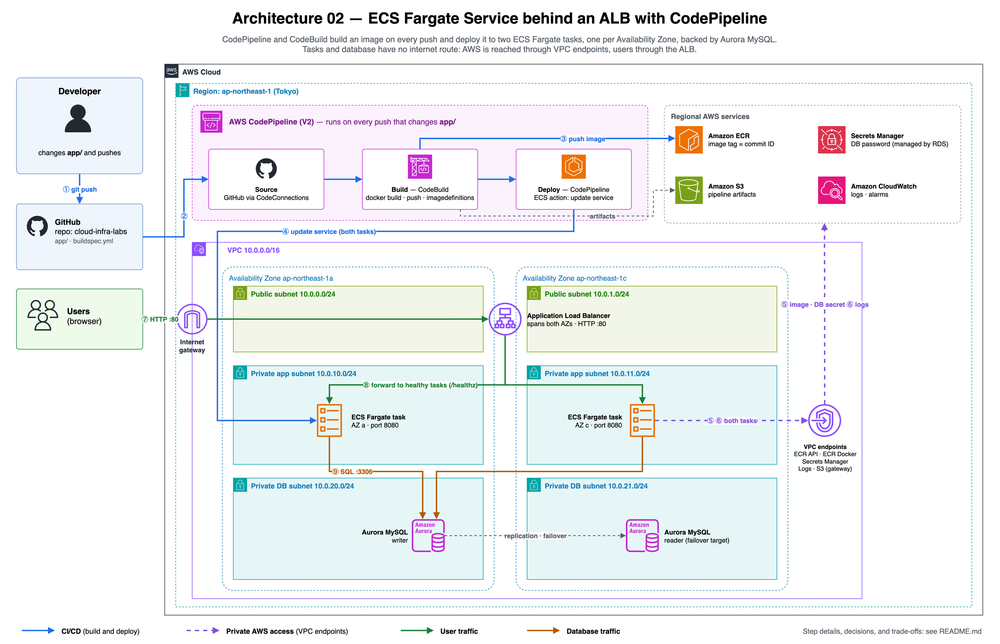

# Lab 01 — ECS Fargate Service behind an ALB with CodePipeline

> Build a highly available container service on AWS with Terraform: an ALB in front of two ECS
> Fargate tasks (one per Availability Zone) running a Java 25 Spring Boot API, backed by Aurora
> MySQL, all in private subnets with no internet route, and deployed by CodePipeline on every push.

**Category:** aws
**Related architecture:** [Architecture 02 — ECS Fargate Service behind an ALB with CodePipeline](../../../architectures/02-ecs-fargate-alb-codepipeline/README.md)

**▶ To run this lab, follow the [step-by-step guide (SETUP.md)](SETUP.md).**

## Goal

A typical company web service needs more than "a container that runs": it must survive the loss
of a server or a whole data center, keep its data safe, stay off the public internet except for
its front door, and ship changes without anyone logging in to servers. This lab builds that
platform from code.

At the end of the lab:

- Users store items and later retrieve or update them at the ALB address, through a web page
  (a table of the items) or the REST API behind it.
- Two tasks run in two Availability Zones; stopping one, or failing over Aurora, doesn't take the
  app down.
- The tasks and the database have no internet route; they reach AWS only through VPC endpoints.
- A push to `main` tests, builds, and deploys the app with no manual steps, and a broken release
  is rolled back automatically.
- Everything is created and destroyed with Terraform.

## Architecture



- **CodePipeline** (Source → Build → Deploy) gets the code from GitHub through
  **CodeConnections**, builds and tests the image in **CodeBuild**, pushes it to **ECR**, and
  tells **ECS** to roll it out.
- The **ALB** in the public subnets is the only entry point; it sends traffic to healthy tasks
  in either AZ.
- **ECS Fargate** runs 2 tasks in the private app subnets; they reach ECR, Secrets Manager, and
  CloudWatch Logs only through **VPC endpoints**.
- **Aurora MySQL** (writer in AZ a, reader in AZ c) stores the data; the password is generated
  by RDS, kept in **Secrets Manager**, and injected into the tasks.

Design details, decisions, and trade-offs are in the
[architecture](../../../architectures/02-ecs-fargate-alb-codepipeline/README.md).

## What you'll practise

| Skill | Where in the guide |
|---|---|
| Containerising a Java 25 / Spring Boot app with a multi-stage build | Steps 4–5 |
| Terraform with a remote S3 state, per-environment variables, and account guards | Steps 6–10 |
| Private networking: 3 subnet tiers, VPC endpoints, no NAT | Steps 10, 17 |
| CI/CD with CodePipeline, CodeBuild, CodeConnections, and ECR | Steps 11–12, 15 |
| ECS Fargate behind an ALB, rolling deployments | Steps 13–15 |
| High availability: task failure and Aurora failover | Steps 16, 18–19 |
| Safe deployments: circuit-breaker rollback | Step 20 |
| Monitoring with CloudWatch alarms | Step 21 |

## Tools and services

| Tool / service | Used for | Version |
|---|---|---|
| Terraform | Creates all AWS resources | 1.17 (`~> 1.17`) |
| AWS provider for Terraform | | 6.73 (`~> 6.73`) |
| Java (Amazon Corretto) | App runtime | 25 (`amazoncorretto:25.0.5-al2023-headless`) |
| Spring Boot | Web framework (Web MVC + JDBC) | 4.1.3 |
| Maven | Builds and tests the app (inside Docker) | 3.9.16 |
| Aurora MySQL | Database | Aurora MySQL 3 (AWS's current default), `db.t4g.medium` in dev |
| ECS on Fargate | Runs the containers | 0.5 vCPU / 1 GB per task in dev |
| CodePipeline / CodeBuild | CI/CD | Pipeline V2; `amazonlinux-x86_64-standard:5.0` build image |
| Application Load Balancer, ECR, Secrets Manager, CloudWatch, VPC endpoints | See the architecture | — |

## Files in this lab

```
labs/aws/01-ecs-fargate-alb-codepipeline/
├── README.md                this overview
├── SETUP.md                 step-by-step guide (index) → setup/1-prepare.md … 5-clean-up.md
├── app/                     Java 25 Spring Boot API + web page
│   ├── pom.xml
│   ├── Dockerfile           Maven build stage + Corretto 25 runtime stage
│   └── src/                 controller, repository, schema.sql, static/index.html (web page), tests
└── terraform/
    ├── versions.tf          Terraform, provider, S3 backend
    ├── variables.tf         inputs set per environment
    ├── outputs.tf
    ├── common_local.tf      naming rule (name_prefix) and common tags
    ├── <service>.tf         resources:  vpc, endpoint, securitygroup, alb, ecr, ecs, rds,
    ├── <service>_local.tf   names + settings for the same services, s3, iam, codebuild, codepipeline, cloudwatch
    ├── buildspec/
    │   └── buildspec.yml    CodeBuild steps: build, push, write imagedefinitions.json
    ├── policy/
    │   ├── iam/             trust policy + one permission policy per role (JSON)
    │   └── s3/              artifact bucket policy: HTTPS only (JSON)
    ├── env/
    │   ├── dev/  terraform.tfvars, backend.hcl
    │   ├── stg/  terraform.tfvars, backend.hcl
    │   └── prd/  terraform.tfvars, backend.hcl
    └── bootstrap/           one-time per account: the state bucket (s3.tf + s3_local.tf, policy/s3/)
```

## Terraform structure

This structure is specific to this lab; other labs in this repository may organise Terraform
differently. Each AWS service has **two files**, so names and settings are easy to find and
change without touching the resource code:

| File | Holds | Example |
|---|---|---|
| `<service>.tf` | The resources only, reading values from `local.*` | `s3.tf`: the bucket, encryption, public access block |
| `<service>_local.tf` | That service's names and settings | `s3_local.tf`: bucket name, `force_destroy` |
| `env/<env>/terraform.tfvars` | Only what differs per environment | CIDRs, sizes, branch, protection, retention |
| `env/<env>/backend.hcl` | Where that environment's state is stored | state bucket and key |
| `buildspec/` | Files the AWS resources read, kept next to the code that uses them | `buildspec.yml` for the CodeBuild project in `codebuild.tf` |
| `policy/<service>/*.json` | IAM and S3 policies as plain JSON, with `${...}` placeholders filled in by `templatefile()` in the matching `_local.tf` / `.tf` | `policy/iam/codebuild_policy.json` ← `iam_local.tf` |

### Why this structure

Common ways to organise Terraform, and why this lab uses the one above:

| Approach | How it works | Why not here |
|---|---|---|
| One big `main.tf` | Every resource in one file | Hard to find anything past a few hundred lines; every review touches the same file |
| A copy of the code per environment (`dev/`, `stg/`, `prd/` folders with their own `.tf` files) | Each environment has its own full set of files | The copies drift apart over time: a fix made in dev is forgotten in prd |
| Terraform workspaces | One configuration, `terraform workspace select dev` | All environments share one backend and one set of credentials, so it is easy to apply to the wrong environment; it doesn't fit separate AWS accounts |
| Reusable modules (`modules/network`, `modules/ecs`, …) called from a thin root per environment | Each component is a module with inputs and outputs | The right choice when **several apps or teams reuse** the same components. For one app it adds a layer of variables and outputs to trace through, with no reuse to pay for it |
| Terragrunt | A wrapper tool that generates backends and keeps environment configuration DRY | Another tool to install and learn; plain Terraform does the job here |
| **Chosen: one root configuration, `<service>.tf` + `<service>_local.tf`, `env/<env>/`** | One codebase for every environment; each environment only supplies its differences | See below |

Why the chosen layout works well:

- **One codebase, no drift.** dev, stg, and prd run exactly the same `.tf` files. An environment
  differs only by its `terraform.tfvars`, so the differences are visible in one small file each.
- **Easy to find and review.** Each AWS service has its own pair of files. A change to a name or a
  setting (CPU, retention, thresholds) touches only `<service>_local.tf`; the resource code in
  `<service>.tf` stays the same, so reviews are short and low-risk.
- **Names in one place.** All names come from `local.name_prefix`, so the naming rule is applied
  the same way everywhere and can be checked in one pass.
- **Safe across accounts, with no account ID in the code.** The account comes from your AWS
  login, and each environment's state bucket name contains its account ID, so with the wrong
  login `terraform init` finds no state and stops.
- **No extra tools.** Plain Terraform and the AWS provider only.

Trade-offs, honestly:

- A setting lives in `<service>_local.tf` and is used in `<service>.tf`, so you sometimes open two
  files to follow one value.
- All resources share one state per environment: a plan always checks the whole stack. For a
  much larger system, split it into several states (for example network, data, app) or move to
  modules.
- Nothing is packaged for reuse by other projects; if a second app needs the same platform, the
  next step is to turn the service files into modules.

## Naming and tagging

Every AWS resource in this lab follows one rule, defined once in
[common_local.tf](terraform/common_local.tf). The project code is **`awslab01`** (this lab), and
the environment is `dev`, `stg`, or `prd`:

```
{project}-{env}-{resource}[-{purpose}][-{az}]        e.g. awslab01-dev-sg-app, awslab01-dev-subnet-app-1a
```

- Lowercase letters, digits, and hyphens only (S3, ALB, and RDS reject anything else).
- `{resource}` uses AWS's own ID prefixes where they exist: `vpc`, `subnet`, `igw`, `rtb`, `vpce`, `sg`.
- Names stay within AWS limits: ALB and target group 32 characters, IAM roles 64, S3 63.
  S3 names are global, so they end with the account ID and region.
- Resources with no name field get a `Name` tag.
- Every resource gets the tags `Project`, `Environment`, `ManagedBy = terraform`, and
  `Repository`, for cost reports and for finding resources.

| Resource | dev name |
|---|---|
| VPC / internet gateway | `awslab01-dev-vpc`, `awslab01-dev-igw` |
| Subnets | `awslab01-dev-subnet-public-1a`, `awslab01-dev-subnet-app-1a`, `awslab01-dev-subnet-db-1a` (+ `-1c`) |
| Route tables | `awslab01-dev-rtb-public`, `awslab01-dev-rtb-private` |
| VPC endpoints | `awslab01-dev-vpce-ecr-api`, `-ecr-dkr`, `-secretsmanager`, `-logs`, `-s3` |
| Security groups | `awslab01-dev-sg-alb`, `awslab01-dev-sg-app`, `awslab01-dev-sg-db`, `awslab01-dev-sg-vpce` |
| ALB / target group | `awslab01-dev-alb`, `awslab01-dev-tg-app` |
| ECR repository | `awslab01-dev-app` |
| ECS | `awslab01-dev-cluster`, `awslab01-dev-service-app`, `awslab01-dev-task-app` |
| Aurora | `awslab01-dev-aurora`, `awslab01-dev-aurora-1a` (writer), `awslab01-dev-aurora-1c` (reader), `awslab01-dev-dbsubnet` |
| IAM roles | `awslab01-dev-role-ecs-task-execution`, `awslab01-dev-role-ecs-task`, `awslab01-dev-role-codebuild`, `awslab01-dev-role-codepipeline` |
| S3 | `awslab01-dev-s3-artifacts-<account-id>-ap-northeast-1`, `awslab01-dev-s3-tfstate-<account-id>-ap-northeast-1` |
| CI/CD | `awslab01-dev-github`, `awslab01-dev-build`, `awslab01-dev-pipeline` |
| Logs | `/ecs/awslab01-dev/app`, `/aws/codebuild/awslab01-dev-build` |
| Alarms | `awslab01-dev-alb-5xx`, `awslab01-dev-alb-unhealthy-hosts`, `awslab01-dev-ecs-cpu-high`, `awslab01-dev-aurora-cpu-high`, `awslab01-dev-aurora-connections-high` |

## Environments and accounts

The code supports **dev, stg, and prd**, each in its **own AWS account**, as in most companies:
a mistake in dev can't touch production, and each account has its own bill and permissions.
Everything is separate per environment: account, state bucket, network, pipeline, and branch.
**This lab deploys only dev.**

| Setting | dev | stg | prd |
|---|---|---|---|
| AWS account | dev account | stg account | prd account |
| VPC CIDR | `10.0.0.0/16` | `10.1.0.0/16` | `10.2.0.0/16` |
| Pipeline branch | `main` | `release/stg` | `release/prd` |
| Task size | 0.5 vCPU / 1 GB | 0.5 vCPU / 1 GB | 1 vCPU / 2 GB |
| Aurora instances | `db.t4g.medium` | `db.t4g.medium` | `db.r7g.large` |
| Backup retention | 1 day | 7 days | 14 days |
| Log retention | 7 days | 14 days | 30 days |
| Deletion protection | off | off | **on** |
| `force_destroy` (final snapshot, non-empty buckets) | yes | yes | **no** |

No file holds an AWS account ID: Terraform reads it from your AWS login
(`data.aws_caller_identity`). What keeps environments apart:
- **Your login picks the account.** Each environment has its own AWS CLI profile; check it with
  `aws sts get-caller-identity` before running Terraform.
- **The state bucket name contains the account ID**, and `terraform init` builds that name from
  your login. With the wrong login, `init` looks for a bucket that doesn't exist in that account
  and stops.
- Each environment has its own `backend.hcl` (its own state key), so its state can never be
  mixed with another's.

Trade-off: an earlier version pinned the account with the provider's `allowed_account_ids`,
which needs the ID written in a file. Without it, the one unguarded step is the bootstrap
(step 7): with the wrong login it would create a state bucket in that account. Check
`aws sts get-caller-identity` first.

**To deploy stg or prd** (same steps as the guide, with that environment's files):

```bash
export AWS_PROFILE=<your-stg-profile>
aws sts get-caller-identity --query Account --output text   # must be your stg account
# replace the GitHub placeholder in env/stg/terraform.tfvars (like step 6)
cd terraform/bootstrap && terraform init && terraform apply -var-file=../env/stg/terraform.tfvars && cd ..
ACCOUNT_ID=$(aws sts get-caller-identity --query Account --output text)
terraform init -reconfigure -backend-config=env/stg/backend.hcl \
  -backend-config="bucket=awslab01-stg-s3-tfstate-${ACCOUNT_ID}-ap-northeast-1"
terraform apply -var-file=env/stg/terraform.tfvars -var app_desired_count=0
```

Then follow Part 3 with `stg` in the names. The stg pipeline deploys the `release/stg` branch,
so promoting a release means merging `main` into `release/stg` (and later into `release/prd`).

## Problems I hit and how I fixed them

> Filled in while building and running the lab.

| Problem | Cause | Fix |
|---|---|---|
| The unit tests for `POST /items` returned `503` instead of `201` | After the `INSERT`, the code asked for the generated keys. The H2 test database returned two (`id` and the defaulted `updated_at`), so Spring couldn't pick the ID; the error handler turned that into 503 | Ask for the `id` column only: `.update(keys, "id")`. Verified against H2 in the tests and against real MySQL 8.0 |
| On Fargate the tasks exited with code 1 (`Unable to start web server`) and the target group showed them unhealthy; the same image worked locally | The task's root file system is read-only and `/tmp` is a Fargate volume, which is owned by root (`0755`). The app ran as `USER 10001`, so Tomcat couldn't write its temp folder in `/tmp`. Locally there is no read-only file system or volume, so `/tmp` was writable. (Worked out from the AWS docs on Fargate bind mounts; the exact `Caused by` log line wasn't checked, but the fix below confirmed it) | Removed `USER 10001` from the Dockerfile, so the app runs as root and can write `/tmp`; both targets became healthy. Running as non-root again is listed in the architecture's improvements |
| The AWS account ID had to be written in `env/dev/terraform.tfvars` and `env/dev/backend.hcl`, files in a public repo, so it could be committed by mistake | The provider's `allowed_account_ids` check only works with an ID typed in advance, and a backend file can't use variables or locals, so the state bucket name had to be written out in full | Read the ID from the AWS login (`data.aws_caller_identity` → `local.account_id`) and pass the bucket name to `terraform init` on the command line (step 8). Trade-off: `allowed_account_ids` is gone; with the wrong login, `init` now stops because that account has no state bucket. Checked with `terraform fmt` and `terraform validate`; the new `init` hasn't been run yet |
| After `terraform destroy`, the final check still listed resources: the ECS cluster and service, VPC endpoints, security group rules, the state bucket, and task definitions `awslab01-dev-task-app:1` to `:5` | Three causes. The tag search reads an index that updates later than the resources, so deleted ones stay listed for a while. The state bucket is only deleted by the bootstrap's own destroy, the next step. And every pipeline run registers a new task definition revision that Terraform doesn't know about, so `destroy` leaves revisions 2–5 (revision 1 only becomes inactive) | Cleaned up, then added step 23 (deregister and delete the task definitions) and a note in step 26 that deleted resources can stay listed for a while |
| After the lab, `main` still said `items-api-v2`, so the next run or fork would start at v2 and step 15's `sed` would change nothing | Step 15 pushes a change to `main` to show a deployment, and nothing undid it: step 20 only reverts its own commit | Put the name back to `items-api`, and added step 27, which does this at the end of every run |

## Cost

About **$0.43 per hour (~$10 per day)** for dev, mostly the two Aurora instances and the VPC
endpoints. See the [architecture's cost estimate](../../../architectures/02-ecs-fargate-alb-codepipeline/README.md#cost-estimate).
To remove everything, follow [Part 5 — Clean up](setup/5-clean-up.md).

## What I'd do differently

> Written after the lab is finished. Planned production improvements are listed in the
> [architecture](../../../architectures/02-ecs-fargate-alb-codepipeline/README.md#what-id-improve-next).

## References

- [Amazon ECS: Fargate and services](https://docs.aws.amazon.com/AmazonECS/latest/developerguide/AWS_Fargate.html)
- [ECS deployment circuit breaker](https://docs.aws.amazon.com/AmazonECS/latest/developerguide/deployment-circuit-breaker.html)
- [ECR interface VPC endpoints](https://docs.aws.amazon.com/AmazonECR/latest/userguide/vpc-endpoints.html)
- [Passing Secrets Manager secrets to ECS tasks](https://docs.aws.amazon.com/AmazonECS/latest/developerguide/secrets-envvar-secrets-manager.html)
- [Aurora: password management with Secrets Manager](https://docs.aws.amazon.com/AmazonRDS/latest/AuroraUserGuide/rds-secrets-manager.html)
- [CodePipeline: ECS deploy action](https://docs.aws.amazon.com/codepipeline/latest/userguide/action-reference-ECS.html)
- [CodePipeline V2 triggers](https://docs.aws.amazon.com/codepipeline/latest/userguide/pipelines-triggers.html)
- [CodeConnections for GitHub](https://docs.aws.amazon.com/dtconsole/latest/userguide/connections-create-github.html)
- [Terraform S3 backend](https://developer.hashicorp.com/terraform/language/backend/s3)
- [Terraform AWS provider](https://registry.terraform.io/providers/hashicorp/aws/latest/docs)
- [AWS tagging best practices](https://docs.aws.amazon.com/whitepapers/latest/tagging-best-practices/tagging-best-practices.html)
- [Spring Boot reference](https://docs.spring.io/spring-boot/index.html)
- [Amazon Corretto 25](https://docs.aws.amazon.com/corretto/latest/corretto-25-ug/what-is-corretto-25.html)
