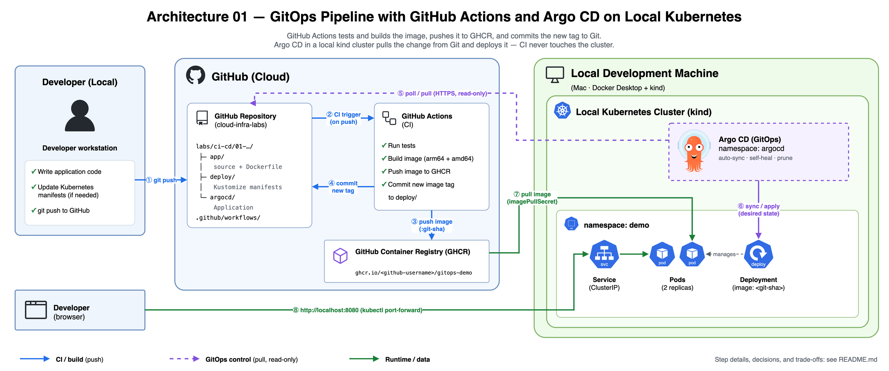

# Lab 01 — GitOps Pipeline with GitHub Actions and Argo CD on Local Kubernetes

> Build a GitOps pipeline on a Mac: every push to GitHub is tested, built, and deployed to a
> local Kubernetes cluster by Argo CD, with no `kubectl apply` and no cluster credentials in CI.

**Category:** ci-cd
**Related architecture:** [Architecture 01 — GitOps Pipeline with GitHub Actions and Argo CD on Local Kubernetes](../../../architectures/01-gitops-github-actions-argocd/README.md)

**▶ To run this lab, follow the [step-by-step guide (SETUP.md)](SETUP.md).**

## Goal

Deploying with `kubectl apply` from a laptop or from CI is hard to audit, easy to get wrong,
and means CI needs cluster credentials. This lab replaces that with GitOps: Git holds the
desired state, and the cluster pulls it.

At the end of the lab:

- A push to `main` runs the tests, builds the image for arm64 and amd64, pushes it to GHCR,
  and commits the new image tag to Git.
- Argo CD detects the new tag and deploys it to the local kind cluster automatically.
- A manual change in the cluster is reverted by Argo CD (self-heal).
- Rolling back is a `git revert`.

## Architecture



- **GitHub Actions** is the CI: it tests, builds, and publishes the image, then writes the
  new tag into `deploy/`. It never talks to the cluster.
- **GHCR** stores the images, tagged with the Git commit SHA.
- **Argo CD** runs inside the kind cluster, polls the repo, and applies whatever `deploy/`
  describes.
- **Kubernetes** runs the app as a Deployment with 2 pods behind a ClusterIP Service, and
  pulls the image with a read-only `imagePullSecret`.
- **You** reach the app at `http://localhost:8080` through `kubectl port-forward`.

Design details, decisions, and trade-offs are in the
[architecture](../../../architectures/01-gitops-github-actions-argocd/README.md).

## What you'll practise

| Skill | Where in the guide |
|---|---|
| Local Kubernetes with kind | Steps 6, 8 |
| Multi-arch container builds (arm64 + amd64) | Steps 9, 11 |
| Kubernetes manifests with Kustomize, readiness probes | Step 10 |
| CI with GitHub Actions and GHCR | Step 11 |
| GitOps with Argo CD: auto-sync, self-heal, prune | Steps 12–14 |
| Least-privilege access: read-only `imagePullSecret` | Step 13 |
| Drift recovery and rollback with Git | Steps 19–20 |

## Tools and services

| Tool / service | Used for | Version |
|---|---|---|
| Docker Desktop | Runs containers and the kind cluster | 29.9.2 |
| kind | Local single-node Kubernetes cluster | 0.33.0 |
| kubectl (with Kustomize) | Talks to the cluster; renders manifests | 1.36.1 (Kustomize 5.8.1) |
| Argo CD | GitOps controller in the cluster | 3.6.2 |
| argocd CLI | Logs in to and controls Argo CD | 3.6.2 |
| GitHub Actions | CI: test, build, push, commit tag | `ubuntu-24.04` runner; action versions in the workflow file |
| GHCR | Container registry | — |
| Python | The demo web app (standard library only) | 3.13 (`python:3.13-slim` image) |

Install sources and setup: [SETUP.md, Part 1](SETUP.md#part-1--prepare-your-mac).

## Files in this lab

```
labs/ci-cd/01-gitops-github-actions-argocd/
├── README.md                 this overview
├── SETUP.md                  step-by-step guide
├── cluster/
│   └── kind-config.yaml      kind cluster definition
├── app/
│   ├── server.py             demo web app (/ and /healthz)
│   ├── test_server.py        unit tests (run locally and in CI)
│   ├── Dockerfile            image build, non-root user
│   └── .dockerignore
├── deploy/                   desired state that Argo CD applies
│   ├── kustomization.yaml    namespace + image name/tag (updated by CI)
│   ├── deployment.yaml       2 replicas, probes, security context
│   └── service.yaml          ClusterIP Service
└── argocd/
    └── application.yaml      Argo CD Application (auto-sync, self-heal, prune)

.github/workflows/ci-cd-01-gitops.yml   CI workflow (repo root; runs only when this lab changes)
```

## Problems I hit and how I fixed them

> Filled in while building the lab.

| Problem | Cause | Fix |
|---|---|---|
| Pods stuck in `ImagePullBackOff` after the first Argo CD sync | The GHCR token was mis-pasted when creating the `ghcr-pull` secret; the error only appeared later, when the pods tried to pull | Recreated the secret with a correct token. Step 13 now tests the token first (length check, `docker login`, `docker pull`) before the cluster depends on it |
| `git revert` stopped with `CONFLICT` in `deploy/kustomization.yaml` during the rollback test | I reverted the commit of the version I wanted to return to. `git revert` means "undo this commit", not "go back to it"; a newer tag commit had changed the same `newTag` line since | `git revert --abort`, then reverted the newest tag commit. Step 20 now shows the list with an example and says to revert only the top line |
| `curl http://localhost:8080` failed right after the rollback, although Argo CD showed `Synced` and `Healthy` | `kubectl port-forward svc/demo` attaches to a single pod; the rollout replaced that pod, so the tunnel closed | Restarted the port-forward. Step 20 now says to restart it after a rollout |

## Cost

**$0.** Everything runs on the Mac; GitHub Actions and GHCR are used within GitHub's free
tier. To remove everything afterwards, see [SETUP.md, Part 4 — Clean up](SETUP.md#part-4--clean-up).

## What I'd do differently

> Written after the lab is finished. Planned production improvements are listed in the
> [architecture](../../../architectures/01-gitops-github-actions-argocd/README.md#what-id-improve-next).

## References

- [Argo CD documentation](https://argo-cd.readthedocs.io/)
- [kind documentation](https://kind.sigs.k8s.io/)
- [GitHub Actions documentation](https://docs.github.com/actions)
- [Working with the GitHub Container registry](https://docs.github.com/packages/working-with-a-github-packages-registry/working-with-the-container-registry)
- [Kustomize documentation](https://kubectl.docs.kubernetes.io/references/kustomize/)
- [Docker multi-platform builds](https://docs.docker.com/build/building/multi-platform/)
