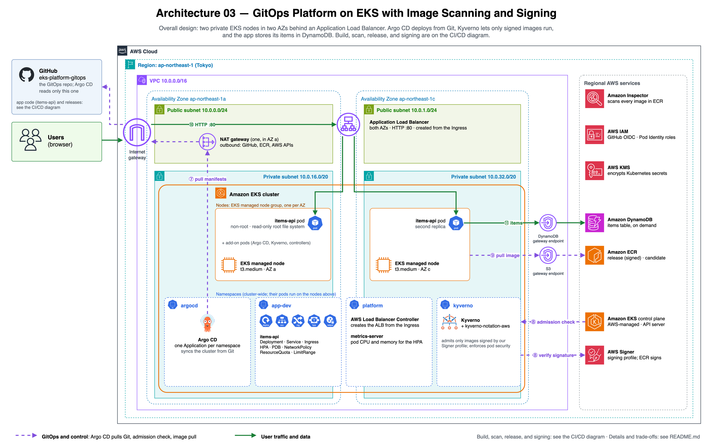
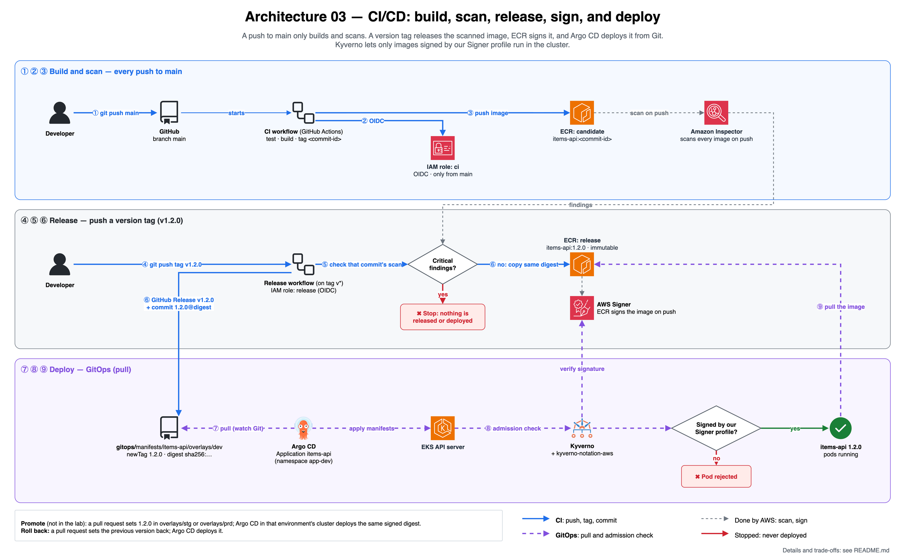

# Lab 01 — GitOps Platform on EKS with Image Scanning and Signing

> Build a private Amazon EKS platform where a version tag releases an image only if Amazon
> Inspector found no critical vulnerabilities, ECR signs it with AWS Signer, Argo CD deploys it
> from a separate GitOps repository, and the cluster refuses any image that isn't signed by your
> own signing profile.

**Category:** kubernetes
**Related architecture:** [Architecture 03 — GitOps Platform on EKS with Image Scanning and Signing](../../../architectures/03-eks-gitops-image-scanning-signing/README.md)

**▶ To run this lab, follow the [step-by-step guide (SETUP.md)](SETUP.md).**

## Goal

The simple way to run an app on Kubernetes is a CI job that builds an image and runs
`kubectl apply`. It works, but the CI job then holds cluster credentials, any image that builds
can run (including one with a known critical vulnerability, or one pushed by hand from a
laptop), and nobody can say for sure what is running or roll it back cleanly.

This lab builds the platform-team version instead. Code, deployment configuration, and
infrastructure live in separate repositories; Git is the only way to change what runs; and the
cluster itself checks every image.

At the end of the lab:

- A push to `main` in `sample-web-app` builds, tests, and scans an image, and **deploys nothing**.
- A version tag (`v1.0.0`) releases that exact image (same digest) only if Inspector found **no
  critical vulnerability**; ECR signs it with AWS Signer; a pull request in `eks-platform-gitops`
  deploys it to dev through Argo CD, with no other manual step.
- A release with Log4Shell in it **stops at the scan**, and nothing is released or deployed.
- The cluster **refuses** an unsigned image, an image from any other repository, and a pod that
  would run as root, while the released app runs: two pods in two Availability Zones behind an
  Application Load Balancer, with its data in DynamoDB.
- Argo CD puts back changes made by hand, and a rollback is a pull request.
- No long-lived AWS keys exist anywhere, and **no AWS account ID is written in any file** of the
  three repositories.

## Architecture





- **`sample-web-app` (GitHub):** the app (Java 25, Spring Boot) and two workflows. **ci** builds
  and pushes every commit of `main` to ECR `candidate`, where Inspector scans it. **release**, on
  a `v*` tag, checks the scan, copies the image to ECR `release` (immutable tags, signed on push
  by ECR managed signing with AWS Signer), and opens a pull request in the GitOps repository
  through a GitHub App.
- **`eks-platform-gitops` (GitHub):** what runs in the cluster. Argo CD objects (`apps/`) are kept
  apart from the manifests (`manifests/`); one Argo CD Application per namespace; the app is
  plain Kustomize with one overlay per environment. Only dev's version may change without a
  review.
- **EKS (Terraform):** a private cluster across two Availability Zones with a managed node group,
  VPC CNI network policies, EKS Pod Identity, and one NAT gateway (Argo CD reads GitHub).
- **Admission control:** OPA Gatekeeper checks every new pod in `app-*` namespaces; it asks
  Ratify, which verifies the signature against your Signer profile and asks AWS Signer about
  revocation. Kubernetes' built-in Pod Security Admission enforces the `restricted` level.
- **Per-account values** (ECR registry, cluster name, VPC ID) never appear in Git: Terraform sets
  them as annotations on the cluster's entry in Argo CD, and the ApplicationSets fill them in.

Design details, decisions, and trade-offs are in the
[architecture](../../../architectures/03-eks-gitops-image-scanning-signing/README.md).

## What you'll practise

| Skill | Where in the guide |
|---|---|
| GitHub as a platform: template repositories, CODEOWNERS, branch protection, a GitHub App with least privilege | Steps 5, 7, 8 |
| Terraform in layered stacks with remote state, community modules, and your own modules | Steps 9–13 |
| EKS: managed node group, access entries, add-ons, Pod Identity, IRSA | Steps 12, 13 |
| Supply-chain security on AWS: Inspector scanning, ECR managed signing, AWS Signer | Steps 15, 16, 19 |
| GitHub Actions with OIDC (no AWS keys), pinned actions, and a release gate | Steps 14–16, 19 |
| GitOps with Argo CD: app-of-apps, ApplicationSets, self-heal, rollback by pull request | Steps 13, 17, 23, 24 |
| Kubernetes admission control: Gatekeeper, Ratify, Pod Security Admission | Steps 13, 20, 21 |
| High availability on Kubernetes: topology spread, PodDisruptionBudget, ALB with pod targets | Steps 17, 18, 22 |
| Safe clean-up of resources created outside Terraform (the load balancer) | Steps 25–32 |

## Tools and services

| Tool / service | Used for | Version |
|---|---|---|
| Terraform | All AWS resources; installs Gatekeeper, Ratify, and Argo CD | 1.17 (written against 1.17.1) |
| Terraform providers | `aws`, `awscc` (ECR managed signing), `helm`, `kubernetes` | 6.74.0, 1.111.0, 3.3.0, 3.6.0 (lock files) |
| Terraform modules | `terraform-aws-modules`: `vpc`, `eks`, `eks-pod-identity` | 6.9.0, 21.30.2, 2.11.0 |
| Amazon EKS | Kubernetes control plane, managed node group (2 × `t3.medium`) | Kubernetes 1.36 |
| Amazon ECR + Amazon Inspector | Image registry; enhanced scanning (on push, and continuous for releases) | — |
| AWS Signer | Signing profile used by ECR managed signing (Notation format) | — |
| Amazon DynamoDB | The app's items (on demand) | — |
| Argo CD | GitOps controller (Helm chart `argo-cd`, plus `argocd-apps` for the root Application) | Chart 10.18.0 (Argo CD v3.6.1), 2.0.8 |
| OPA Gatekeeper | Admission policies | 3.23.1 |
| Ratify | Signature verification for Gatekeeper, with the AWS Signer plugin | 1.4.8 (chart 1.15.9) |
| AWS Load Balancer Controller | The ALB from the Ingress | Chart 3.6.3 |
| metrics-server | Pod CPU for the HorizontalPodAutoscaler | Chart 3.14.0 (0.9.0) |
| GitHub Actions | CI and release; every action pinned by commit SHA | checkout 7.0.1, configure-aws-credentials 6.3.0, amazon-ecr-login 2.1.7, setup-buildx 4.4.1, build-push 7.4.0, create-github-app-token 3.3.0 |
| The app | Java 25 (Amazon Corretto 25.0.5), Spring Boot 4.2.0, AWS SDK for Java 2.59.11 | — |
| AWS CLI, kubectl, GitHub CLI | Your machine | AWS CLI 2, kubectl 1.35 or later, gh 2 |

Install sources and setup: [Part 1 — Prepare](setup/1-prepare.md).

## Files in this lab

```
labs/kubernetes/01-eks-gitops-image-scanning-signing/
├── README.md                    this overview
├── SETUP.md                     step-by-step guide (index)
├── setup/                       the guide, in five parts, plus troubleshooting
├── verify/
│   └── admission-test-pod.yaml  a pod that follows every rule except its image (step 20)
└── terraform/
    ├── bootstrap/               the state bucket (its own small state stays local)
    ├── stacks/
    │   ├── 1-network/           VPC, subnets, NAT gateway, S3 + DynamoDB gateway endpoints
    │   ├── 2-cluster/           EKS cluster, add-ons, managed node group
    │   └── 3-platform/          image pipeline, GitHub access, DynamoDB, Pod Identity,
    │                            admission control, Argo CD
    ├── modules/
    │   ├── image-pipeline/      ECR candidate + release, Inspector, Signer, managed signing
    │   ├── github-oidc/         GitHub's OIDC provider and the ci and release roles
    │   ├── admission-control/   Gatekeeper, Ratify, Ratify's IAM role, AWS Signer root certificate
    │   └── argocd-bootstrap/    Argo CD, the cluster's entry with its annotations, the root Application
    └── environments/
        └── {dev,stg,prd}/       bootstrap, network, cluster, and platform .tfvars
```

The app and the GitOps configuration are in their own repositories, `sample-web-app` and
`eks-platform-gitops` (see [the guide](SETUP.md)).

## Terraform structure

This structure is specific to this lab; [aws/01](../../aws/01-ecs-fargate-alb-codepipeline/README.md#terraform-structure)
uses a different one on purpose, so the two can be compared.

| Part | Holds | State |
|---|---|---|
| `bootstrap/` | The S3 state bucket for one environment | Local (`terraform.tfstate`, not committed): the bucket can't hold its own state before it exists |
| `stacks/1-network/` | The VPC and everything in it | `<env>/network.tfstate` |
| `stacks/2-cluster/` | EKS and its node group | `<env>/cluster.tfstate` |
| `stacks/3-platform/` | What runs on or serves the cluster | `<env>/platform.tfstate` |
| `modules/` | This lab's own modules, called by the platform stack | — |
| `environments/<env>/<stack>.tfvars` | Only what differs per environment, one file per stack | — |

Each stack is a plain Terraform root with the standard files: `backend.tf`, `versions.tf`,
`providers.tf`, `variables.tf`, `locals.tf`, `data.tf`, `main.tf`, and `outputs.tf`. A stack
finds what an earlier stack made **by name or tag** (data sources), never by reading its state.
The state bucket and key are given to `terraform init` with `-backend-config`, because the
bucket's name contains the account ID.

### Why this structure

| Approach | Why not here |
|---|---|
| One root configuration for everything (as in aws/01) | With Kubernetes and Helm providers in the same root, Terraform must connect to a cluster that doesn't exist yet in the same run, and every plan touches the VPC, the cluster, and Argo CD at once |
| A copy of the code per environment | The copies drift apart over time |
| Terraform workspaces | All environments share one backend and one set of credentials; it doesn't fit one AWS account per environment |
| Terragrunt | Another tool to learn; plain Terraform handles four stacks well |
| **Chosen: layered stacks with remote state, community modules for standard parts, small own modules** | See below |

- **Small blast radius.** A change to the platform can't touch the VPC or the cluster: they are in
  other states. A plan shows only its own layer.
- **Providers connect only to things that exist.** The platform stack's Kubernetes and Helm
  providers connect to a cluster created by an earlier, finished stack.
- **Community modules for the standard parts** (`vpc`, `eks`, `eks-pod-identity`): widely used,
  pinned to exact versions. **Own modules for what is specific to this platform**: the image
  pipeline, GitHub access, admission control, and the Argo CD bootstrap.
- **One codebase for every environment.** dev, stg, and prd differ only in their `.tfvars` files.
- **No account ID in any file.** It comes from your AWS login; the state bucket's name contains
  it, so with the wrong login `terraform init` finds no state and stops.

Trade-offs: the stacks must be applied in order (and destroyed in reverse), and a value from an
earlier stack is found by name, so names must stay stable. For many teams and environments,
Terragrunt or a CI pipeline per stack would be the next step.

## Naming and tagging

Every name follows `{project}-{env}[-{purpose}][-{az}]`, with project code **`k8slab01`**
(this lab) and environment `dev`, `stg`, or `prd`:

| Resource | Name in dev |
|---|---|
| State bucket | `k8slab01-dev-tfstate-<account-id>-ap-northeast-1` (bucket names are global, so the account ID and region make it unique) |
| VPC, EKS cluster | `k8slab01-dev` |
| Subnets | `k8slab01-dev-public-1a`, `k8slab01-dev-private-1c`, … |
| Node group | `k8slab01-dev-default` |
| ECR repositories | `k8slab01-dev/candidate/sample-web-app`, `k8slab01-dev/release/sample-web-app` |
| Signer profile | `k8slab01_dev_release_…` (Signer allows only letters, digits, and underscores; a random suffix, because a canceled profile's name can't be used again) |
| IAM roles | `k8slab01-dev-github-ci`, `k8slab01-dev-github-release`, `k8slab01-dev-ratify`; Pod Identity roles `k8slab01-dev-sample-web-app-…` and `k8slab01-dev-aws-lb-controller-…` (the module adds a random suffix) |
| DynamoDB table | `k8slab01-dev-items` |
| Kubernetes namespaces | `argocd`, `gatekeeper-system`, `platform`, `app-dev` |
| Load balancer | Named by the AWS Load Balancer Controller: `k8s-appdev-samplewe-…` |

Tags on every AWS resource Terraform creates: `Project=k8slab01`, `Environment=<env>`,
`ManagedBy=terraform`, and `Stack=<bootstrap|network|cluster|platform>`. The load balancer gets
`Project`, `Environment`, and `ManagedBy=aws-load-balancer-controller` from the Ingress, so the
clean-up check (step 32) finds it too.

## Environments and accounts

dev, stg, and prd are each meant to be **their own AWS account**, with their own state bucket,
cluster, and Argo CD. The Terraform and the GitOps repository already contain all three: their
`.tfvars` differ in network ranges (`10.0`, `10.1`, `10.2`), node size (prd: three `t3.large`),
and protection (in prd, `terraform destroy` refuses to delete ECR repositories that hold images,
or the DynamoDB table), and each has a Kustomize overlay (prd runs 3–6 pods).

**This lab deploys only dev.** Two things are not built for stg and prd:

- The workflows push only to dev's ECR repositories. For a cluster in another account to run a
  release, the signed image must also be in that account's `release` repository (for example
  with ECR cross-account replication) or in one shared registry account; and that account's
  Ratify must trust the profile that signed it.
- Promotion is a pull request in `eks-platform-gitops` that sets the same version and digest in
  `overlays/stg` or `overlays/prd`; it waits for a code owner's review (and GitHub doesn't let you
  approve your own pull request, so a one-person setup needs an administrator merge).

## Problems I hit and how I fixed them

> Filled in while running the lab on AWS. Never invent entries.

| Problem | Cause | Fix |
|---|---|---|

## Cost

About **$0.33 per hour (~$8–9 per day)** for dev, mostly the EKS control plane ($0.10 per hour),
the two `t3.medium` nodes, and the NAT gateway, plus about $1 of Inspector scans per lab run.
See the [architecture's cost estimate](../../../architectures/03-eks-gitops-image-scanning-signing/README.md#cost-estimate).
To remove everything, follow [Part 5 — Clean up](setup/5-clean-up.md).

## What I'd do differently

> Written after the lab is finished. Planned production improvements are listed in the
> [architecture](../../../architectures/03-eks-gitops-image-scanning-signing/README.md#what-id-improve-next).

## References

- [Amazon EKS: access entries](https://docs.aws.amazon.com/eks/latest/userguide/access-entries.html)
- [Amazon EKS Pod Identity](https://docs.aws.amazon.com/eks/latest/userguide/pod-identities.html)
- [IAM roles for service accounts (IRSA)](https://docs.aws.amazon.com/eks/latest/userguide/iam-roles-for-service-accounts.html)
- [Amazon ECR enhanced scanning (Amazon Inspector)](https://docs.aws.amazon.com/AmazonECR/latest/userguide/image-scanning-enhanced.html)
- [Amazon ECR managed signing](https://docs.aws.amazon.com/AmazonECR/latest/userguide/managed-signing.html)
- [AWS Signer: signing container images](https://docs.aws.amazon.com/signer/latest/developerguide/container-workflow.html)
- [Ratify on AWS (with AWS Signer)](https://ratify.dev/docs/quickstarts/ratify-on-aws)
- [OPA Gatekeeper](https://open-policy-agent.github.io/gatekeeper/website/docs/)
- [Kubernetes Pod Security Admission](https://kubernetes.io/docs/concepts/security/pod-security-admission/)
- [Argo CD ApplicationSet: cluster generator](https://argo-cd.readthedocs.io/en/stable/operator-manual/applicationset/Generators-Cluster/)
- [AWS Load Balancer Controller](https://kubernetes-sigs.github.io/aws-load-balancer-controller/latest/)
- [GitHub Actions: OpenID Connect in AWS](https://docs.github.com/en/actions/security-for-github-actions/security-hardening-your-deployments/configuring-openid-connect-in-amazon-web-services)
- [GitHub Apps in GitHub Actions workflows](https://docs.github.com/en/apps/creating-github-apps/authenticating-with-a-github-app/making-authenticated-api-requests-with-a-github-app-in-a-github-actions-workflow)
- [Kustomize: images](https://kubectl.docs.kubernetes.io/references/kustomize/kustomization/images/)
- [Terraform S3 backend](https://developer.hashicorp.com/terraform/language/backend/s3)
- [terraform-aws-modules/eks](https://registry.terraform.io/modules/terraform-aws-modules/eks/aws/latest)
- [CVE-2021-44228 (Log4Shell)](https://nvd.nist.gov/vuln/detail/CVE-2021-44228)
